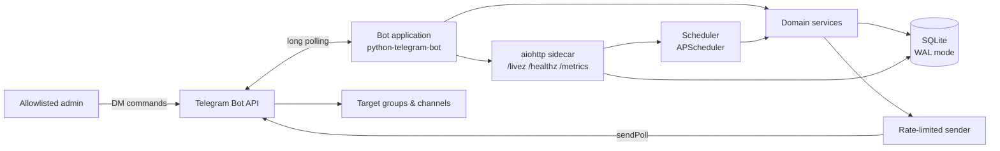
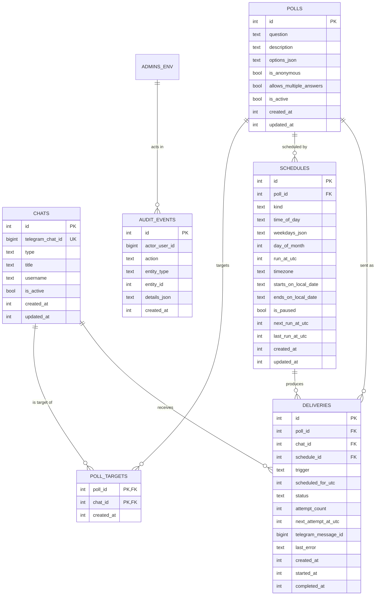

# Project Constitution — `telegram-auto-poll`

| Field | Value |
|---|---|
| Document | Project Constitution |
| Version | 1.0.0 |
| Status | Ratified |
| Ratified on | 2026-10-31 |
| Owner | Project maintainers |
| Applies to | The entire repository, all branches, all contributors, and all AI agents |
| Review cadence | Annually, and whenever an architectural or process decision changes |
| Supersedes | None (initial ratification) |

> This document is the highest-authority engineering artifact in the repository. It defines what the
> project is, how it is built, how quality is enforced, and how decisions are made. When this document
> and any other artifact disagree, this document wins until it is formally amended.

---

## At a glance

| Question | Answer |
|---|---|
| What is it? | A private Telegram bot that publishes saved polls to configured groups and channels on a schedule. |
| Admin interface | Telegram direct messages only, restricted by a numeric user-ID allowlist. No web UI. |
| Polls | Many reusable regular polls: question 1–300 chars, optional description 0–1024, 2–12 options of 1–100; anonymous and multiple-answer flags. |
| Schedules | Daily, weekly, monthly, and one-off; per-schedule IANA timezone, start/end dates, pause/resume. |
| Delivery | At most once per occurrence per chat; bounded retries; missed runs skipped after a 120 s grace window. |
| Stack | Python 3.12, `uv`, `python-telegram-bot`, APScheduler, SQLAlchemy 2.0 + SQLite (WAL), Alembic, `aiohttp`. |
| Deployment | One Docker container on one VPS via Docker Compose. Exactly one replica. |
| Quality | `ruff`, `mypy --strict`, `pytest` at 100% line and branch coverage, plus SAST, dependency, secret, and container scans. |
| Process | The 17-step SDD workflow with four human gates (G1–G4) defined in §12. |
| License | MIT. |

---

## 0. How to read this document

### 0.1 Normative language

The key words **MUST**, **MUST NOT**, **REQUIRED**, **SHALL**, **SHOULD**, **SHOULD NOT**,
**RECOMMENDED**, **MAY**, and **OPTIONAL** are to be interpreted as described in
[RFC 2119](https://www.rfc-editor.org/rfc/rfc2119) and [RFC 8174](https://www.rfc-editor.org/rfc/rfc8174).

- **MUST / MUST NOT** — a hard rule. Violations block merge and, if discovered later, must be fixed.
- **SHOULD / SHOULD NOT** — the default. A deviation requires a documented reason in the PR or an ADR.
- **MAY** — genuinely optional.

### 0.2 Precedence

```
CONSTITUTION.md  >  docs/adr/*  >  specs/<feature>/spec.md  >  plan.md  >  tasks.md  >  code and comments
```

- An ADR may refine or narrow a rule in this document, but it **MUST NOT** contradict a hard rule
  without an accompanying constitution amendment.
- A spec may add feature-specific constraints but **MUST NOT** weaken project-wide constraints.
- If code and an artifact disagree, the code is presumed wrong until the artifact is amended.

### 0.3 Audience and obligations

- **Human contributors** must follow the workflow in §12 and the standards in §13.
- **AI agents** must read this document before changing the repository, must obey every human gate in
  §12.8, and must never treat an unanswered question as approval.
- **Reviewers** must reject changes that violate a **MUST** rule, even if the change works.
- **Maintainers** own amendments (§18) and the decision log (§18.4).

### 0.4 Scope of this document

This is a *project constitution*, not a feature specification. It defines the mission, architecture,
domain rules, engineering standards, quality gates, and delivery process. Feature-level behavior is
specified per feature under `specs/`, using the templates in `specs/templates/`.

---

## 1. Mission, scope, and non-goals

### 1.1 Mission

**`telegram-auto-poll` is a private Telegram bot that publishes native Telegram polls to configured
groups and channels at predetermined recurring or one-off times.** Administrators manage polls,
schedules, and target chats entirely through direct messages with the bot; no web interface exists.

The project must be small, dependable, auditable, and operable by one person on a single VPS. A poll
that is due must be delivered once, on time, to every configured target — and the operator must be
able to see exactly what happened.

### 1.2 In scope (v1)

1. Telegram only, one bot token, one deployment.
2. Native **regular** polls (not quizzes) with:
   - a question (1–300 characters),
   - an optional description (0–1024 characters),
   - 2–12 answer options (each 1–100 characters),
   - configurable anonymity (default: anonymous),
   - configurable multiple answers (default: single answer).
3. Many independent polls, each with its own options, flags, target chats, and schedules.
4. Recurring schedules: daily, weekly (selected ISO weekdays), monthly (day of month), and one-off
   datetimes. Multiple schedules per poll.
5. Per-schedule IANA timezone, start date, optional end date, pause/resume.
6. Delivery to multiple registered groups/supergroups/channels.
7. Admin access via a Telegram user-ID allowlist supplied through environment variables.
8. Admin command interface with guided inline-keyboard wizards and shortcuts.
9. Chat registration by forwarding a message or pasting a chat ID.
10. Idempotent delivery, bounded retries, missed-run handling, and admin alerts.
11. Delivery and audit history, structured logs, health and Prometheus metrics endpoints.
12. Docker image and Docker Compose deployment on a single VPS.
13. 100% line and branch test coverage of application code, strict typing, and automated security checks.

### 1.3 Out of scope (v1)

These are deliberately deferred. They **MUST NOT** be added without a spec, an ADR, and a constitution
amendment where relevant.

- Web UI, REST API, or any browser-based administration.
- Quiz polls, media-attached polls, photo polls, poll results ingestion, or vote analytics.
- Open-period/close-date automation, shuffle options, revoting, country restrictions, or member-only polls.
- Per-chat schedules (v1 schedules apply to all active targets of a poll).
- Multiple bot tokens, multi-tenant operation, or multiple simultaneous deployments.
- Horizontal scaling, multiple replicas, PostgreSQL, Redis, or an external job queue.
- Platforms other than Telegram (Discord, Slack, WhatsApp, etc.).
- Internationalization; the bot and documentation are English-only.
- Runtime management of the admin allowlist; changes require an environment update and restart.
- Automatic deployment from CI to the VPS; deployment is an explicit operator action.
- Public distribution of the bot; it is a private operational tool.

### 1.4 Hard operating constraints

These constraints are architectural, not preferences:

| ID | Constraint | Reason |
|---|---|---|
| C-1 | Exactly **one** application instance per bot token. | Telegram long polling permits one consumer, and in-process scheduling must not duplicate. |
| C-2 | No web UI and no public HTTP surface. | The admin interface is Telegram DM only; health/metrics are published only on host loopback. |
| C-3 | SQLite is the only datastore. | Zero-ops, single-writer, sufficient for the target capacity. |
| C-4 | Long polling, not webhooks. | No public domain, TLS termination, or ingress is required. |
| C-5 | The application runs as a single asyncio process. | Simplicity, shared in-memory state, one migration owner. |
| C-6 | All times are stored as UTC instants; schedules carry an IANA timezone. | Correctness across DST and host timezone changes. |
| C-7 | The bot never reads or stores individual votes. | Privacy by design; Telegram owns poll results. |

Capacity target: up to **50 registered chats**, **200 polls**, **1,000 schedules**, and **500 deliveries
per day**, with a database under 100 MB.

---

## 2. Core principles

Each principle is normative and has an enforcement mechanism. A PR that violates a principle must
either be changed or explicitly justified under §18.5.

### P1 — Specification before code

No production code is written until the feature has an approved spec, plan, and task list (Step 6
gate). Tests are written from the spec before the implementation. Code that cannot be traced to an
approved artifact is out of scope.

*Enforced by:* §12 workflow, PR template, Definition of Ready/Done.

### P2 — One source of truth

The SQLite database is the single source of truth for polls, schedules, targets, and delivery history.
The scheduler derives work from the database and rebuilds its state on startup. There is no second
configuration file that can drift, and no durable scheduler job store.

*Enforced by:* §3.4, §5, §12.

### P3 — At-most-once delivery, never silent failure

A poll occurrence is sent **at most once per chat**. Duplicate suppression is enforced by a database
uniqueness constraint, not by hope. Ambiguous outcomes (for example, a crash after the HTTP request was
sent) are recorded as failures and surfaced to an admin, never blindly retried.

*Enforced by:* §5.3 invariants, §6.5, §11.

### P4 — Secure and private by default

Only allowlisted Telegram user IDs may issue admin commands, and only in direct messages. Secrets live
in environment variables or Docker secrets, never in the repository, image, logs, or error messages.
Polls are anonymous unless explicitly configured otherwise, and the bot stores no voter data.

*Enforced by:* §10, CI secret scanning, code review.

### P5 — Small, typed, asynchronous

Prefer the standard library and the smallest dependency set that solves the problem. All application
code is fully type-annotated and passes `mypy --strict`. I/O is asynchronous; the event loop is never
blocked. Abstractions are introduced only when a second concrete use exists.

*Enforced by:* §4, §13, CI.

### P6 — Test-first, evidence over assertion

Every behavior change starts with a failing test that expresses the acceptance criterion. The suite is
deterministic: no network, no real clock, no sleeps, no shared mutable state. Coverage is a floor, not
a goal; 100% coverage with weak assertions is still a failure.

*Enforced by:* §11, coverage gate.

### P7 — Operability is a feature

The service must be easy to deploy, observe, back up, restore, upgrade, and roll back. Logs are
machine-readable, health is explicit, failures alert a human, and every operational procedure has a
runbook. A feature that cannot be operated is not done.

*Enforced by:* §14–§16, Definition of Done.

### P8 — Reversible, forward-only changes

Prefer changes that can be rolled back by redeploying the previous image. Database migrations are
forward-only and must be backward-compatible for at least one release. Destructive actions require
confirmation and, where data is involved, a backup.

*Enforced by:* §14, §15.5.

### P9 — Explicit over implicit

No hidden defaults for security-relevant behavior. Configuration is validated at startup and fails
fast with an actionable message. Errors are typed, logged with context, and surfaced — never swallowed.
Magic numbers become named constants.

*Enforced by:* §8, §13.5.

### P10 — Documentation lives with the code

Behavior changes update the relevant documentation in the same PR: README, runbook, `.env.example`,
ADRs, and specs. Documentation drift is a defect.

*Enforced by:* §17, PR checklist.

---

## 3. System architecture

### 3.1 Context



There is exactly one long-running process. It hosts four supervised asyncio components:

1. **Telegram bot** — receives admin updates via long polling and sends polls.
2. **Scheduler** — evaluates due schedules and creates delivery records.
3. **Delivery worker** — drains pending deliveries with rate limiting and retries.
4. **Observability sidecar** — serves `/livez`, `/healthz`, and `/metrics` on the private container
   interface, published only on host loopback.

### 3.2 Components and responsibilities

| Component | Responsibility | Must not do |
|---|---|---|
| `bot/` | Telegram update parsing, admin authorization, wizards, rendering, callback routing. | Contain business rules or direct SQL. |
| `domain/` | Entities, value objects, validation, schedule mathematics, state transitions, ports. | Perform I/O, import Telegram, or import SQLAlchemy. |
| `services/` | Use-case orchestration, transaction boundaries, audit events, policy. | Render Telegram messages or know about HTTP. |
| `db/` | SQLAlchemy models, repositories, migrations, engine configuration. | Contain business policy. |
| `scheduler/` | APScheduler wiring, due-work calculation, delivery worker lifecycle. | Duplicate domain logic. |
| `observability/` | Health checks, metrics registry, JSON logging configuration. | Mutate domain state. |
| `app.py` | Composition root, lifecycle, signal handling, single-instance lock. | Contain feature logic. |

### 3.3 Runtime topology

- **Deployment:** one Docker Compose service (`bot`) on one VPS, one named volume mounted at `/data`.
- **Process model:** one container, one Python process, one event loop.
- **Database file:** `/data/telegram-auto-poll.db` with WAL journal, `foreign_keys=ON`,
  `busy_timeout=5000`, `synchronous=NORMAL`.
- **Single-instance lock:** the process takes an exclusive `flock` on `/data/app.lock` at startup and
  exits non-zero if another instance holds it. This guards against accidental double deployment.
- **Network:** outbound HTTPS to `api.telegram.org` only. The health server listens on the container's
  private interface (`HEALTH_HOST=0.0.0.0` in Compose) and the host publishes it only on
  `127.0.0.1:8080`. It is never published on `0.0.0.0`. In local development the default binds
  `127.0.0.1`.
- **Clock:** the host must run NTP. Schedule evaluation uses UTC instants and a zoneinfo database; the
  image includes `tzdata`.

### 3.4 Scheduling and delivery data flow

1. An admin creates or edits a poll, its targets, and one or more schedules over DM.
2. The service validates the definition and computes `next_run_at_utc` from the schedule's local rules
   and IANA timezone.
3. APScheduler holds **in-memory** jobs that wake the scheduler at the next due instant. The database,
   not APScheduler, is authoritative; jobs are rebuilt from the database at startup and reconciled
   after every schedule mutation.
4. At the due instant, the scheduler computes the occurrence, inserts one `deliveries` row per active
   target with status `pending`, and advances `next_run_at_utc` in the same transaction. The unique
   constraint on `(schedule_id, scheduled_for_utc, chat_id)` makes this idempotent.
5. The delivery worker claims pending rows, applies per-chat and global rate limits, calls
   `sendPoll`, and records `sent` plus the Telegram message ID.
6. Retryable failures update the same delivery row with a future `next_attempt_at_utc`; non-retryable
   failures and exhausted retries mark it `failed` and alert all admins once.
7. If the process was down past the grace window, the occurrence is recorded as `skipped` and logged;
   it is not sent late.

### 3.5 Process lifecycle

Startup order (fail fast; abort on any error):

1. Parse and validate configuration; never log secrets.
2. Configure JSON logging.
3. Create `/data` if needed; acquire the single-instance lock.
4. Open the database, apply PRAGMAs, run the pre-migration backup, and apply Alembic migrations.
5. Recover deliveries left in `sending` (mark `failed` with an ambiguous-outcome error; alert later).
6. Recover schedules: skip occurrences older than the grace window, leave within-grace occurrences due,
   and recompute next runs.
7. Start the observability sidecar.
8. Rebuild scheduler jobs from the database and start the scheduler.
9. Start Telegram long polling; register the private-chat command menu.
10. Log `startup_complete` with version, environment, and counts.

Shutdown on `SIGTERM`/`SIGINT`:

1. Stop accepting Telegram updates.
2. Stop the scheduler and delivery worker from claiming new work.
3. Drain in-flight sends for at most 30 seconds.
4. Flush logs, close the database, release the lock, exit 0. A forced exit must still preserve the
   single-instance guarantee.

### 3.6 Why these choices

| Decision | Rationale | Recorded in |
|---|---|---|
| Python 3.12 + `uv` | Modern typing, `zoneinfo`, deterministic locked installs. | ADR-0001 |
| `python-telegram-bot` | Mature async Bot API client with long-polling and conversation support. | ADR-0001 |
| APScheduler 3.x `AsyncIOScheduler` | Mature cron/interval triggers and timezone handling; in-memory jobs avoid a second source of truth. | ADR-0001 |
| SQLAlchemy 2.0 async + `aiosqlite` | Typed ORM, migrations, and async access with a tiny operational footprint. | ADR-0001 |
| SQLite WAL | Single-writer safety with concurrent reads and simple backup. | ADR-0001 |
| Telegram-only admin | No web attack surface, no frontend build, no session auth. | ADR-0002 |
| aiohttp sidecar | Minimal async HTTP server for health and metrics without an ASGI stack. | ADR-0001 |

### 3.7 Dependency direction

```
bot ──► services ──► domain
 │          │
 │          └────► db (repositories)
 └────► observability
scheduler ──► services
app ──► everything (composition root only)
```

- `domain/` imports only the standard library and its own modules.
- `services/` may import `domain/` and repository ports; it must not import `bot/` or `scheduler/`.
- `bot/` and `scheduler/` are adapters; they depend on services, never the reverse.
- Cross-layer communication uses `typing.Protocol` ports defined in `domain/ports.py`.
- Import cycles are forbidden and must be caught by review and a lint rule.

---

## 4. Technology stack

### 4.1 Mandated stack

| Layer | Choice | Constraints |
|---|---|---|
| Language | Python 3.12.x | No 3.13+ until the stack and base image are validated by an ADR. |
| Packaging | `uv` with `pyproject.toml` and committed `uv.lock` | CI and Docker use `uv sync --frozen`; `pip` is not used for builds. |
| Telegram | `python-telegram-bot` (current stable major) | Long polling only; no webhook. |
| Scheduling | `APScheduler` 3.x, `AsyncIOScheduler` | In-memory job store only; DB is authoritative. |
| Database | SQLite 3 via `SQLAlchemy` 2.0 async + `aiosqlite` | WAL mode, foreign keys on, short transactions. |
| Migrations | Alembic 1.x | Auto-run at startup with a pre-migration backup. |
| Config | `pydantic-settings` 2.x | Environment only; validated at startup. |
| HTTP sidecar | `aiohttp` 3.x | Private container interface; published only on host loopback. `/livez`, `/healthz`, `/metrics`. |
| Metrics | `prometheus-client` | Pull model; no push gateway. |
| Logging | Standard library `logging` + a JSON formatter | No third-party logging framework required. |
| Time zones | `zoneinfo` + `tzdata` package in the image | IANA identifiers only; no fixed offsets. |
| Tests | `pytest`, `pytest-asyncio`, `pytest-cov`, `coverage.py` | Deterministic; no network. |
| Lint/format | `ruff` (lint + format) | Replaces flake8, isort, black. |
| Types | `mypy --strict` | No untyped defs, no implicit `Any`. |
| Security | `bandit`, `pip-audit`, `gitleaks`, CodeQL, Trivy | Enforced in CI (§11.6). |
| Container | Docker multi-stage build; Docker Compose | Python 3.12 slim base, pinned by digest. |

### 4.2 Dependency policy

1. The standard library is preferred. A new runtime dependency **MUST** be justified in the PR with:
   the problem it solves, why the standard library is insufficient, its maintenance status, license,
   and security posture.
2. Runtime dependencies are pinned through `uv.lock`; `pyproject.toml` may use compatible ranges, but
   builds **MUST** use the lockfile. Unpinned installs in CI or Docker are forbidden.
3. `uv lock --upgrade` changes are isolated in a dedicated dependency PR and pass the full suite.
4. Dev dependencies are separated from runtime dependencies in optional dependency groups.
5. Licenses must be compatible with MIT. A dependency with an incompatible or unknown license is
   rejected.
6. No dependency may be downloaded or installed by an agent without human approval, per the project's
   operating rules.
7. Dependabot (or equivalent) **MUST** be enabled for Python packages, GitHub Actions, and Docker base
   images; security updates are prioritized.

### 4.3 Quality configuration (single source of truth)

`pyproject.toml` is authoritative for tooling configuration. The constitution defines the intent; the
configuration implements it.

- `ruff`: line length 100, target `py312`, format check in CI, rule families including `E`, `F`, `I`,
  `N`, `UP`, `B`, `SIM`, `ASYNC`, `S`, `C4`, `PT`, `RUF`, `ANN`. Security rules (`S`) are mandatory.
- `mypy`: `strict = true`, `warn_unreachable = true`, `no_implicit_reexport = true`. Explicit `Any`
  requires a comment explaining why.
- `pytest`: `--strict-markers`, `--strict-config`, `asyncio_mode = "auto"`, branch coverage on,
  `fail_under = 100`.
- `coverage`: source limited to `src/telegram_auto_poll`; exclusions are listed in §11.3.

---

## 5. Domain model and invariants

### 5.1 Entity relationships



`ADMINS_ENV` is not a table: the allowlist is configuration. It appears in the diagram only to show
that audit events record the acting Telegram user ID.

### 5.2 Tables and fields

#### `chats`

| Column | Type | Rules |
|---|---|---|
| `id` | INTEGER PK | Surrogate key. |
| `telegram_chat_id` | BIGINT | Unique, not null. Groups/supergroups are negative; channels start with `-100`. |
| `type` | TEXT | One of `group`, `supergroup`, `channel`. |
| `title` | TEXT | 1–255 characters, from `getChat`. |
| `username` | TEXT | Nullable public username, without `@`. |
| `is_active` | INTEGER (bool) | Soft-deactivation; inactive chats are skipped. |
| `created_at` | INTEGER | Unix epoch seconds, UTC. |
| `updated_at` | INTEGER | Unix epoch seconds, UTC. |

Chats are never hard-deleted while referenced, to preserve delivery history.

#### `polls`

| Column | Type | Rules |
|---|---|---|
| `id` | INTEGER PK | Surrogate key; shown to admins as poll number. |
| `question` | TEXT | 1–300 characters after trimming. |
| `description` | TEXT | Nullable; 0–1024 characters after trimming. Empty becomes NULL. |
| `options_json` | TEXT | JSON array of 2–12 strings, each 1–100 characters, unique (case-insensitive, trimmed). |
| `is_anonymous` | INTEGER (bool) | Default 1. Telegram forces anonymity in channels. |
| `allows_multiple_answers` | INTEGER (bool) | Default 0. |
| `is_active` | INTEGER (bool) | 0 means archived; schedules are paused on archive. |
| `created_at`, `updated_at` | INTEGER | Unix epoch seconds, UTC. |

#### `poll_targets`

| Column | Type | Rules |
|---|---|---|
| `poll_id` | INTEGER FK → `polls.id` | `ON DELETE RESTRICT`. Part of composite PK. |
| `chat_id` | INTEGER FK → `chats.id` | `ON DELETE RESTRICT`. Part of composite PK. |
| `created_at` | INTEGER | Unix epoch seconds, UTC. |

A poll must have at least one active target before it can have an active schedule.

#### `schedules`

| Column | Type | Rules |
|---|---|---|
| `id` | INTEGER PK | Surrogate key; shown to admins as schedule number. |
| `poll_id` | INTEGER FK → `polls.id` | `ON DELETE RESTRICT`. |
| `kind` | TEXT | `daily`, `weekly`, `monthly`, or `once`. |
| `time_of_day` | TEXT | `HH:MM` in 24-hour local time; null for `once`. |
| `weekdays_json` | TEXT | JSON array of ISO weekdays 1–7 (Mon–Sun); required for `weekly`, otherwise null. |
| `day_of_month` | INTEGER | 1–31; required for `monthly`, otherwise null. |
| `run_at_utc` | INTEGER | Epoch seconds; required for `once`, otherwise null. |
| `timezone` | TEXT | Valid IANA identifier, e.g. `Europe/London`. |
| `starts_on_local_date` | TEXT | `YYYY-MM-DD` in `timezone`; null means the creation date. |
| `ends_on_local_date` | TEXT | `YYYY-MM-DD` in `timezone`, inclusive; null means no end. |
| `is_paused` | INTEGER (bool) | Paused schedules are not evaluated. |
| `next_run_at_utc` | INTEGER | Epoch seconds; null when paused, expired, or exhausted. |
| `last_run_at_utc` | INTEGER | Epoch seconds of the most recent occurrence handled. |
| `created_at`, `updated_at` | INTEGER | Unix epoch seconds, UTC. |

#### `deliveries`

| Column | Type | Rules |
|---|---|---|
| `id` | INTEGER PK | Surrogate key; used in alerts and `/resend`. |
| `poll_id` | INTEGER FK → `polls.id` | `ON DELETE RESTRICT`. |
| `chat_id` | INTEGER FK → `chats.id` | `ON DELETE RESTRICT`. |
| `schedule_id` | INTEGER FK → `schedules.id` | `ON DELETE SET NULL`; null for manual sends. |
| `trigger` | TEXT | `scheduled` or `manual`. |
| `scheduled_for_utc` | INTEGER | Epoch seconds of the intended occurrence (or manual send time). |
| `status` | TEXT | `pending`, `sending`, `sent`, `failed`, `skipped`. |
| `attempt_count` | INTEGER | Number of send attempts; starts at 0. |
| `next_attempt_at_utc` | INTEGER | Epoch seconds; null unless a retry is scheduled. |
| `telegram_message_id` | BIGINT | Nullable; set on success. |
| `last_error` | TEXT | Nullable; sanitized, no token or secret. |
| `created_at`, `started_at`, `completed_at` | INTEGER | Epoch seconds, UTC. |

**Uniqueness:** a partial unique index on `(schedule_id, scheduled_for_utc, chat_id)` where
`schedule_id IS NOT NULL` guarantees one scheduled delivery per occurrence per chat. Manual sends are
explicitly allowed to duplicate and are distinguished by `trigger = 'manual'`.

#### `audit_events`

| Column | Type | Rules |
|---|---|---|
| `id` | INTEGER PK | Surrogate key. |
| `actor_user_id` | BIGINT | Telegram user ID of the admin. |
| `action` | TEXT | Stable verb, e.g. `poll.create`, `schedule.pause`, `chat.register`. |
| `entity_type` | TEXT | `poll`, `schedule`, `chat`, `delivery`, `config`. |
| `entity_id` | INTEGER | Nullable surrogate ID. |
| `details_json` | TEXT | JSON object of non-secret fields; never tokens. |
| `created_at` | INTEGER | Unix epoch seconds, UTC. |

Audit events are immutable. They are written in the same transaction as the mutation they describe.

### 5.3 Invariants

These **MUST** hold after every transaction. Tests must assert them.

| ID | Invariant |
|---|---|
| I-1 | `question` length is 1–300 characters; `description` is 0–1024; each option is 1–100. |
| I-2 | A poll has 2–12 options; no option is blank; options are unique after trimming and case folding. |
| I-3 | `timezone` is a valid IANA identifier resolvable by `zoneinfo`. |
| I-4 | A `weekly` schedule has 1–7 distinct ISO weekdays; a `monthly` schedule has a day 1–31. |
| I-5 | A `once` schedule has `run_at_utc` in the future at creation/update time; it has no time-of-day fields. |
| I-6 | `starts_on_local_date <= ends_on_local_date` when both are present. |
| I-7 | A schedule with a future occurrence has `next_run_at_utc` not null; a paused or expired schedule has it null. |
| I-8 | For every active schedule, `next_run_at_utc` is strictly greater than the occurrence that produced it, and greater than `created_at`. |
| I-9 | A delivery row exists exactly once per `(schedule_id, scheduled_for_utc, chat_id)`. |
| I-10 | A delivery in status `sent` has `telegram_message_id` and `completed_at` set. |
| I-11 | A delivery in status `pending` has `next_attempt_at_utc` null or future; a failed/skipped delivery has `completed_at` set. |
| I-12 | An active schedule belongs to an active poll with at least one active target. |
| I-13 | Archived polls have no active schedules. |
| I-14 | All epoch-second columns are UTC; all local-date columns are interpreted in the schedule's timezone. |
| I-15 | No table stores bot tokens, raw Telegram updates, or individual votes. |

### 5.4 State machines

**Poll:** `draft` (created, no target/schedule) → `active` (has at least one active target) → `archived`.
Unarchiving returns a poll to `draft` until a target and schedule are active again. Archived polls
cannot be sent to.

**Schedule:** `active` → `paused` → `active`; `active` → `expired` when no future occurrence remains;
`active`/`paused` → `deleted` (hard delete, confirmed). Expired schedules are retained for history and
may be edited to restore a future occurrence.

**Delivery:** `pending` → `sending` → `sent` | `failed` | `skipped`; `pending` may become `skipped`
if the target is deactivated or the grace window has passed before the send. Retries update a `pending`
row's `next_attempt_at_utc` and `attempt_count`. A row in `sending` at startup is ambiguous and becomes
`failed` (§6.5.5).

### 5.5 Time semantics

1. **Storage:** absolute instants are integer Unix epoch seconds in UTC. Human-facing local rules
   (`time_of_day`, calendar dates, weekdays) are stored as text and always interpreted with the
   schedule's IANA timezone. Naive local datetimes are never stored.
2. **Display:** all admin-facing timestamps show the schedule timezone and the UTC offset, for example
   `Mon 09:00 Europe/London (UTC+01:00)`. The poll preview shows the next five occurrences.
3. **DST spring-forward (nonexistent local time):** the occurrence shifts forward to the first valid
   instant on that local date (e.g. `02:30` becomes `03:00`). It is sent once.
4. **DST fall-back (ambiguous local time):** the first occurrence (`fold=0`) is used, and the poll is
   sent once, not twice.
5. **Monthly on day 29–31:** months that lack the day are skipped; the day is never clamped to the end
   of the month. Admins see a warning when choosing a day above 28.
6. **Weekly:** ISO weekdays 1–7, Monday–Sunday. Multiple days are allowed; each selected day is one
   occurrence per week.
7. **Start/end dates:** local calendar dates in the schedule timezone, both inclusive. A schedule whose
   end date is past becomes `expired`.
8. **One-off:** created in the schedule timezone but stored as a UTC instant. Past instants are rejected.
9. **Grace window:** `SEND_GRACE_SECONDS` (default 120). A due occurrence at most this old may still be
   sent. An occurrence older than the grace window is recorded as `skipped`, never sent late.
10. **Clock:** all now-reads go through the injected `Clock` port. Domain and service code never call
    `datetime.now()` directly. Tests use a controllable fake clock.

---

## 6. Functional requirements

Priority: **P0** = release blocker, **P1** = required for v1, **P2** = should-have within v1.

| ID | Requirement | Priority |
|---|---|---|
| FR-001 | Only allowlisted Telegram user IDs may use admin commands, and only in direct messages. | P0 |
| FR-002 | Admin commands are rate-limited per user to prevent accidental or malicious spam. | P1 |
| FR-003 | Admins register target chats by forwarding a message or pasting a chat ID; the bot validates access. | P0 |
| FR-004 | Admins can deactivate and reactivate registered chats without losing history. | P1 |
| FR-005 | Admins create polls through a guided wizard with question, description, options, and flags. | P0 |
| FR-006 | Admins edit any poll field, duplicate a poll, and preview it before saving. | P0 |
| FR-007 | Polls can be archived and unarchived; archiving pauses all schedules. | P1 |
| FR-008 | Admins can list and inspect polls with their targets, schedules, and next runs. | P1 |
| FR-009 | Admins create daily, weekly, monthly, and one-off schedules with a timezone and date bounds. | P0 |
| FR-010 | Admins edit, pause, resume, and delete schedules with confirmation for destructive actions. | P0 |
| FR-011 | The bot shows the next five occurrences in the schedule timezone before saving. | P1 |
| FR-012 | Due schedules deliver one poll per active target, respecting Telegram limits. | P0 |
| FR-013 | Scheduled delivery is idempotent: no duplicate poll for the same occurrence and chat. | P0 |
| FR-014 | Occurrences missed beyond the grace window are skipped and logged, never sent late. | P0 |
| FR-015 | Retryable send failures retry with bounded backoff; terminal failures alert all admins once. | P0 |
| FR-016 | Admins can send a poll immediately to all active targets after confirmation. | P1 |
| FR-017 | Admins can resend a failed delivery explicitly, creating a new manual delivery. | P2 |
| FR-018 | `/status` reports version, uptime, health, counts, next runs, and recent failures. | P1 |
| FR-019 | Every admin mutation writes an immutable audit event. | P1 |
| FR-020 | Delivery and audit records older than the retention window are pruned daily. | P1 |
| FR-021 | The process exposes liveness, readiness, and Prometheus metrics on the private container interface, published only on host loopback. | P1 |
| FR-022 | Startup recovers interrupted deliveries and reschedules pending work deterministically. | P0 |
| FR-023 | The command menu is registered only for private chats. | P2 |
| FR-024 | Wizards have explicit cancel, timeout, and validation feedback. | P1 |
| FR-025 | `/help` and `/version` describe the available commands and running version. | P2 |
| FR-026 | User-facing errors are actionable and never expose secrets or stack traces. | P0 |

### 6.1 Admin access

- The allowlist is `ADMIN_USER_IDS`, a comma-separated list of positive Telegram user IDs. It is parsed
  at startup; invalid or empty values abort startup.
- The bot accepts admin commands only when `update.effective_chat.type == "private"` and
  `update.effective_user.id` is in the allowlist.
- Non-allowlisted users receive a single generic reply: “This bot is private.” The bot does not reveal
  the allowlist, poll data, or command help.
- Commands in groups, supergroups, and channels are ignored. The bot never responds there. Scheduled
  polls are the only messages it posts to target chats.
- Callback queries are authorized with the same allowlist check against `callback.from_user.id`.
  Callback data is never trusted as proof of identity.
- If an allowlisted admin has never started a private chat with the bot, Telegram will not allow the bot
  to message them. The README and runbook instruct admins to press **Start** once.
- Admin lockout recovery: update `ADMIN_USER_IDS`, restart the container, and verify with `/status`.
  This procedure must be in the runbook.

### 6.2 Command rate limiting

- A per-admin in-memory token bucket limits commands to `ADMIN_COMMANDS_PER_MINUTE` (default 20).
- `/sendnow` and `/resend` have a separate limit of 5 per minute per admin.
- When limited, the bot replies once with the retry-after seconds and does not process the command.
- Rate-limit state is intentionally ephemeral and resets on restart.

### 6.3 Target chat registration

1. Admin sends `/addchat`.
2. Bot explains the two accepted methods:
   - forward any message from the target chat, or
   - paste the numeric chat ID (for example `-1001234567890`).
3. Bot extracts the chat:
   - forwarded messages: `forward_from_chat` (legacy) or the chat carried by `forward_origin`
     (`sender_chat` for a group/supergroup, `chat` for a channel) when present;
   - otherwise, the pasted text must parse as a negative integer.
4. Bot calls `getChat` and accepts only `group`, `supergroup`, or `channel`. Private chats and bots are
   rejected. Polls cannot be sent to channel direct-message chats.
5. Bot calls `getChatMember(chat_id, bot_id)` and verifies membership. For channels it additionally
   requires administrator status with `can_post_messages`; for groups it warns if the bot lacks send
   permission but stores the chat.
6. Bot upserts the chat by `telegram_chat_id`, stores title/type/username, and confirms with the chat ID
   and title.
7. Duplicate registration is idempotent and reactivates a deactivated chat.
8. `/removechat <id>` deactivates a chat after confirmation. It never deletes delivery history. Existing
   scheduled deliveries to that chat are marked `skipped` with reason `chat_inactive`. If the chat was
   the last active target of a poll, that poll’s schedules are paused and the admin is told.

### 6.4 Poll management

- `/newpoll` runs the wizard in §7.3.
- Validation follows I-1 and I-2. Invalid input re-prompts with the specific constraint and the current
  step; it does not discard earlier answers.
- The preview shows the exact `sendPoll` payload semantics: question, description, numbered options,
  anonymity, multiple answers, targets, and the next occurrence. Confirmation creates the poll and any
  schedule drafted in the wizard in one transaction.
- `/poll <id>` shows the definition and inline actions: edit question, edit description, edit options,
  edit flags, edit targets, add/edit schedules, send now, archive/unarchive, duplicate. Removing the
  last active target pauses all of that poll’s schedules and warns the admin.
- Editing a poll affects future deliveries only. Already-created delivery rows keep the poll reference
  and therefore send the definition as it exists at send time. To avoid surprising changes, editing a
  poll with `pending` deliveries requires confirmation; the bot lists affected deliveries.
- Options are edited as a numbered list. Admin can replace one option, add an option (up to 12), remove
  an option (minimum 2), or reorder. Each edit is validated before saving.
- Duplicating a poll copies question, description, options, and flags but **not** targets or schedules.
- Archiving pauses schedules and blocks manual sends; unarchiving leaves schedules paused until the
  admin resumes them.

### 6.5 Scheduled delivery

1. The scheduler wakes on the earliest `next_run_at_utc` and at least every
   `SCHEDULER_TICK_SECONDS` (default 15) as a safety net.
2. For each due, unpaused schedule on an active poll, it computes the occurrence instant and loads the
   poll's active targets.
3. In one transaction it inserts a `deliveries` row per target with `trigger = 'scheduled'`,
   `scheduled_for_utc = occurrence`, and status `pending`, then advances `next_run_at_utc` to the next
   occurrence and sets `last_run_at_utc`. The unique index suppresses duplicates; conflicts are ignored
   idempotently.
4. If the occurrence is older than the grace window, the rows are inserted with status `skipped`,
   reason `missed_grace_window`; the schedule is advanced and a warning is logged.
5. The delivery worker claims pending rows whose `next_attempt_at_utc` is null or past, marks them
   `sending`, re-checks that the poll and chat are active, and calls `sendPoll` with:
   - `chat_id`,
   - `question`,
   - `description` when present,
   - `options`,
   - `is_anonymous`,
   - `allows_multiple_answers`,
   - `type = "regular"`.
6. On success it stores `telegram_message_id`, sets `sent` and `completed_at`, and increments metrics.
7. Rate limits: at most one message per second per chat, at most 20 messages per minute per group, and
   at most 25 messages per second globally. The worker uses a bounded concurrency of
   `SEND_CONCURRENCY` (default 4) and a token bucket per chat. A `429` response honors
   `retry_after` (clamped to 300 seconds) and schedules a retry.
8. Failures are classified:
   - **Retryable:** network timeouts, connection errors, HTTP 5xx, `429 Too Many Requests`, and
     transient Telegram errors.
   - **Non-retryable:** HTTP 400 responses such as `chat not found`, `bot was kicked`, `not enough
     rights`, or invalid poll content.
9. Retry policy: at most `SEND_RETRY_ATTEMPTS` (default 3) total attempts per delivery row. Backoff is
   `SEND_RETRY_BASE_SECONDS * 2^(attempt-1)` with ±20% jitter, capped at 300 seconds. `429` uses the
   server-provided `retry_after` when longer. Retries update the same row; they never create a new one.
10. Terminal failure sets `failed`, `completed_at`, and a sanitized `last_error`, and notifies all
    admins once per delivery with poll ID, chat title/ID, attempt count, error class, and delivery ID.
11. A manual send (`/sendnow`) creates `trigger = 'manual'` delivery rows with
    `scheduled_for_utc = now`; the same sender pipeline and limits apply. Manual sends may duplicate a
    scheduled occurrence by design and require confirmation.
12. `/resend <delivery_id>` creates a new manual delivery for the same poll and chat after confirmation.
    It never mutates the original delivery row.

#### 6.5.1 Idempotency and crash safety

- The database uniqueness constraint is the final authority for scheduled deliveries.
- A delivery is created **before** the network call. A crash after the call is an ambiguous outcome:
  on startup, rows left in `sending` become `failed` with
  `ambiguous_outcome_after_restart`. They are not retried automatically. An admin may inspect and
  explicitly `/resend`.
- The scheduler never relies on APScheduler’s persisted state. Jobs are rebuilt from the database at
  startup and after each mutation.
- If two scheduler ticks race (for example, after a clock adjustment), the unique index collapses them
  to one delivery per target.

#### 6.5.2 Missed runs

- On startup, any occurrence whose instant is older than the grace window relative to now is marked
  `skipped`, not sent.
- Pending deliveries created before a crash are sent only if their occurrence is still within the grace
  window; otherwise they become `skipped`.
- If a schedule became due during downtime and its occurrence is still within the grace window, it is
  left due and the normal scheduler path creates and sends it. No separate replay mechanism exists.
- A startup summary logs the number of skipped occurrences and, when any exist, sends one consolidated
  DM to admins. It never replays a backlog.
- The policy is deliberately fail-safe: it is better to miss a stale poll than to spam a chat hours
  later.

#### 6.5.3 Clock changes

- Schedule evaluation uses the system UTC clock. If the host clock jumps backward, already-created
  delivery rows prevent duplicates; if it jumps forward, overdue occurrences follow the grace policy.
- NTP is a deployment requirement. A clock error is logged when a computed occurrence is more than
  `CLOCK_SKEW_WARNING_SECONDS` (default 60) away from the expected tick boundary.

### 6.6 Status, health, and audit

- `/status` returns: version, environment, uptime, single-instance lock state, database check, scheduler
  heartbeat age, bot polling state, counts (chats, polls, active schedules, pending deliveries), the
  next five scheduled runs, and the last five failures. It must respond within 2 seconds p95.
- `/healthz` returns HTTP 200 only when a database `SELECT 1` succeeds within 1 second and the scheduler
  heartbeat is younger than three tick intervals. Otherwise it returns 503 with a JSON reason list.
- `/livez` returns 200 whenever the process can serve HTTP; it does not touch the database.
- Metrics follow §16.3.
- Audit events are written for every mutation: poll create/edit/archive/unarchive, schedule
  create/edit/pause/resume/delete, chat register/deactivate/reactivate, and manual send/resend.
  Failed authorization attempts are logged but are not audit events (no authenticated actor).

### 6.7 Retention

- A daily maintenance job at 03:15 UTC deletes `deliveries` and `audit_events` older than
  `RETENTION_DAYS` (default 90) in batches of 1,000, then runs `PRAGMA wal_checkpoint(TRUNCATE)`.
- Poll, schedule, and chat definitions are never pruned automatically.
- The job logs the number of deleted rows and the duration. It is safe to run multiple times.

### 6.8 Error handling and admin notifications

- Expected domain errors return a concise, actionable Telegram message; unexpected errors log a
  stack trace with a correlation ID and tell the admin that the error was logged.
- Stack traces are never sent to Telegram.
- Admins are notified once per terminal delivery failure and once per startup with skipped occurrences.
  Notification failures are logged and do not crash the process.
- The bot does not retry Telegram API calls for admin replies indefinitely; it logs and moves on.

---

## 7. Telegram admin interface

### 7.1 Interaction principles

1. **DM only.** Every command works only in a private chat with the bot.
2. **Guided by default.** Multi-field actions use inline-button wizards; shortcuts exist for power
   users but never bypass validation or confirmation.
3. **Destructive actions require confirmation.** Archive, delete, send-now, resend, and chat
   deactivation show a summary and a two-button confirmation.
4. **Always show context.** Every screen includes the poll/schedule identifier and the current step.
5. **One active wizard per admin.** Starting a new wizard while one is active asks to cancel or resume.
6. **Plain text, no HTML injection.** Poll content is sent as plain text. Admin messages that render
   user-supplied text must escape it if any parse mode is ever introduced.
7. **Accessible and concise.** Use short sentences, numbered options, and explicit units. Avoid
   ambiguous icons; labels carry meaning.

### 7.2 Command reference

| Command | Purpose |
|---|---|
| `/start` | Identify the admin, show a short menu, and confirm authorization. |
| `/help` | List commands and explain the wizard/shortcut model. |
| `/version` | Show application version, build SHA, and start time. |
| `/status` | Show health, counts, next runs, and recent failures. |
| `/polls [page]` | Paginated poll list with status and next run. |
| `/poll <id>` | Poll detail with inline actions. |
| `/newpoll` | Start the poll creation wizard. |
| `/chats [page]` | Paginated registered chats. |
| `/addchat` | Register a chat by forwarded message or numeric ID. |
| `/removechat <id>` | Deactivate a chat after confirmation. |
| `/schedules [poll_id] [page]` | Paginated schedules, optionally filtered by poll. |
| `/schedule <id>` | Schedule detail with next five occurrences and actions. |
| `/pause <schedule_id>` | Pause a schedule. |
| `/resume <schedule_id>` | Resume a schedule and recompute its next run. |
| `/delete_schedule <schedule_id>` | Delete a schedule after confirmation. |
| `/sendnow <poll_id>` | Send a poll immediately after confirmation. |
| `/resend <delivery_id>` | Create a new manual delivery for a failed delivery after confirmation. |
| `/archive <poll_id>` | Archive a poll and pause its schedules. |
| `/unarchive <poll_id>` | Unarchive a poll (schedules remain paused). |
| `/cancel` | Cancel the active wizard or confirmation. |

Command names are lowercase and stable. Aliases are not added without an ADR, because they expand the
test matrix and the help surface. Unknown commands receive a short `/help` hint.

### 7.3 Wizard flows

**New poll wizard**

1. Question (text, 1–300). Validate and show remaining characters.
2. Description (text, 0–1024, or **Skip**).
3. Options: enter option text; after each, show the list and **Add another** / **Done**. Enforce 2–12,
   1–100 characters, and uniqueness. **Remove** and **Reorder** are available from the list.
4. Anonymity: inline toggle, default **Anonymous**.
5. Multiple answers: inline toggle, default **Single answer**.
6. Targets: multi-select active chats with checkboxes; require at least one.
7. Schedule: choose **Daily**, **Weekly**, **Monthly**, **One-off**, or **Save without schedule**.
   - Daily: local time.
   - Weekly: ISO weekdays, then local time.
   - Monthly: day of month (warn if 29–31), then local time.
   - One-off: local date and time.
   - All: IANA timezone (default `DEFAULT_TIMEZONE`), optional start date, optional end date.
   - Show the next five occurrences and the UTC instants before accepting.
8. Preview: full poll and schedule summary.
9. Confirm: create the poll, targets, and schedule in one transaction; write audit events; show IDs.

**Edit flows** reuse the same step components and write only on final confirmation. A wizard expires
after 15 minutes of inactivity or on `/cancel`; expired state is discarded, and the bot tells the admin
to start again.

### 7.4 Callback data and pagination

- Callback data is UTF-8 and **MUST NOT** exceed 64 bytes. Use a compact, versioned scheme:
  `v1:<namespace>:<action>:<id>`, for example `v1:p:view:12`, `v1:s:pause:34`, `v1:w:opt:done`.
- Callback handlers validate the actor, parse the version, and reject unknown namespaces without
  mutating state.
- List pages show at most 8 items. Pagination buttons carry the page number and filter; no cursor state
  is stored server-side for read-only lists.
- A callback answer is always sent within 3 seconds; long work is acknowledged first.
- Confirmations store the pending action in the wizard/confirmation state, not in callback data.

### 7.5 Conversation state

- Wizard and confirmation state is in memory, keyed by `(chat_id, user_id)`.
- State is not persisted and is lost on restart; this is acceptable because no mutation is committed
  until the final confirmation.
- A janitor task removes state older than 15 minutes every minute.
- One wizard per admin; the state machine is explicit and unit-tested for every transition.

### 7.6 Message limits and formatting

- Telegram poll limits are enforced before sending: question 1–300, description 0–1024, options 2–12
  (API permits 1–12; this project requires at least 2), option text 1–100.
- Admin text messages are capped at 4,096 characters; long lists are paginated or summarized.
- Inline keyboards are limited to 8 rows by the UI guideline, with at most 4 buttons per row.
- Poll content is never truncated silently. If a value exceeds a limit, the wizard rejects it with the
  exact limit and the current length.

### 7.7 Error and empty states

- Empty lists explain how to create the first item (`/newpoll`, `/addchat`).
- Permission errors explain the required action (`Add the bot as a channel administrator with “Post
  messages”`).
- Validation errors preserve prior input and re-display the step.
- Unexpected errors show a correlation ID that matches the structured log entry.

---

## 8. Configuration

### 8.1 Configuration contract

All configuration is supplied through environment variables, validated at startup by
`pydantic-settings`, and documented in `.env.example`. Unknown variables are ignored, but malformed
values abort startup with a message that names the variable and the expected format — never its secret
value.

| Variable | Required | Default | Validation and meaning |
|---|---|---|---|
| `TELEGRAM_BOT_TOKEN` | Yes | — | BotFather token, format `<digits>:<secret>`. Secret; never logged. |
| `ADMIN_USER_IDS` | Yes | — | Comma-separated positive integers; at least one; duplicates removed. |
| `DATABASE_URL` | No | `sqlite+aiosqlite:////data/telegram-auto-poll.db` | Must be a SQLite URL in production. |
| `DATA_DIR` | No | `/data` | Writable directory for the DB, lock file, and pre-migration backups. |
| `DEFAULT_TIMEZONE` | No | `UTC` | Valid IANA identifier used as the wizard default. |
| `ENVIRONMENT` | No | `production` | `production`, `staging`, or `development`. |
| `LOG_LEVEL` | No | `INFO` | `DEBUG`, `INFO`, `WARNING`, `ERROR`, or `CRITICAL`. |
| `LOG_FORMAT` | No | `json` | `json` in production; `text` allowed in development. |
| `HEALTH_HOST` | No | `127.0.0.1` | Loopback by default. Compose sets `0.0.0.0` on the private container network and publishes only `127.0.0.1` on the host. |
| `HEALTH_PORT` | No | `8080` | 1–65535. |
| `METRICS_ENABLED` | No | `true` | Enables `/metrics`. |
| `SCHEDULER_TICK_SECONDS` | No | `15` | 5–300; safety-net wake-up interval. |
| `SEND_GRACE_SECONDS` | No | `120` | 0–3600; maximum lateness before an occurrence is skipped. |
| `SEND_RETRY_ATTEMPTS` | No | `3` | 1–10; total attempts per delivery. |
| `SEND_RETRY_BASE_SECONDS` | No | `2` | 1–60; base for exponential backoff. |
| `SEND_CONCURRENCY` | No | `4` | 1–20; maximum in-flight sends. |
| `ADMIN_COMMANDS_PER_MINUTE` | No | `20` | 1–120; per-admin command budget. |
| `RETENTION_DAYS` | No | `90` | 1–3650; delivery and audit retention. |
| `DB_BUSY_TIMEOUT_MS` | No | `5000` | 100–60000; SQLite busy timeout. |
| `SHUTDOWN_GRACE_SECONDS` | No | `30` | 1–120; drain window on SIGTERM. |
| `MIGRATE_ON_STARTUP` | No | `true` | Production deployments must leave this `true`. |
| `CLOCK_SKEW_WARNING_SECONDS` | No | `60` | 1–3600; log a warning beyond this skew. |
| `BOT_POLL_TIMEOUT_SECONDS` | No | `30` | 1–60; long-polling timeout. |
| `WIZARD_TTL_SECONDS` | No | `900` | 60–3600; inactive wizard expiry. |
| `BUILD_VERSION` | No | `dev` | Injected at image build; shown by `/version`. |
| `BUILD_SHA` | No | `unknown` | Injected at image build; shown by `/version`. |

`BUILD_VERSION` and `BUILD_SHA` are build metadata, not runtime secrets. The deployment **MUST** inject
them as OCI labels and environment values so `/version` matches the running image tag.

### 8.2 Secrets policy

1. Secrets **MUST NOT** be committed to git, baked into images, written to logs, or included in
   Telegram messages or audit `details_json`.
2. `.env` is git-ignored. `.env.example` contains placeholders only.
3. Docker Compose may use `env_file: .env` with restrictive host permissions (`chmod 600`). Docker
   secrets are an acceptable alternative and are recommended when the host supports them.
4. The bot token is redacted centrally by the logging configuration. Any third-party library log that
   might print the token is configured to `WARNING` or higher.
5. Token rotation is a runbook procedure: revoke in BotFather, update the secret, restart, verify
   `/status`, then confirm the old token is rejected.
6. Admin IDs and chat IDs are sensitive operational data, not secrets. They are not exposed publicly,
   but they may appear in logs and admin messages.

### 8.3 Environment parity

- `development`: text logs allowed, `/metrics` optional, real Telegram optional when tests use fakes.
- `staging`: production-like Docker Compose, separate bot token and database, never pointed at
  production chats.
- `production`: JSON logs, metrics enabled, loopback-only health, migrations on startup, backups enabled.
- Code **MUST NOT** branch on `ENVIRONMENT` for business rules. Environment only affects logging,
  diagnostics, and safety checks.

---

## 9. Non-functional requirements

| ID | Requirement | Target |
|---|---|---|
| NFR-1 | Delivery latency | p99 ≤ 30 s after the scheduled instant, and always within the 120 s grace window. |
| NFR-2 | Duplicate deliveries | Zero for scheduled occurrences; enforced by a unique index. |
| NFR-3 | Availability | 99.5% monthly for the bot process (single VPS; host maintenance excluded). |
| NFR-4 | Capacity | 50 chats, 200 polls, 1,000 schedules, 500 deliveries/day, DB < 100 MB. |
| NFR-5 | Resource envelope | ≤ 256 MB RSS steady state; ≤ 0.25 vCPU average; image ≤ 250 MB compressed. |
| NFR-6 | Startup | ≤ 15 s including migrations on the reference dataset, excluding image pull. |
| NFR-7 | Admin responsiveness | p95 ≤ 2 s for read-only commands, excluding Telegram network time. |
| NFR-8 | Data durability | RPO ≤ 24 h (daily backups); RTO ≤ 1 h for a single-VPS restore. |
| NFR-9 | Log volume | ≤ 50 MB/day at reference load, with rotation and retention at the host. |
| NFR-10 | Security | No critical or high vulnerability in runtime dependencies or the image at release time. |
| NFR-11 | Maintainability | New contributor can run the test suite and the container from the README in ≤ 30 minutes. |
| NFR-12 | Correctness | All schedule-math DST and month-boundary cases covered by tests (§11.4). |

### 9.1 Performance notes

- The scheduler query is indexed by `(is_paused, next_run_at_utc)` and must not scan the full table.
- Delivery inserts are batched per schedule occurrence; one transaction per occurrence, not per chat.
- Database transactions are short. No network calls occur while a transaction is open.
- The sender uses bounded concurrency and per-chat token buckets; a slow chat cannot starve others.
- Health checks are cheap (`SELECT 1`, in-memory heartbeat) and must not block the event loop.

### 9.2 Reliability notes

- The process is supervised by Docker Compose (`restart: unless-stopped`).
- The single-instance lock prevents split-brain scheduling after a misconfigured deploy.
- The database uses WAL, `synchronous=NORMAL`, and a busy timeout. A corrupted database is restored from
  backup (runbook), never “repaired” by deleting rows.
- API rate limits are treated as a normal condition, not an exception: the sender backs off and
  preserves ordering within a chat.

---

## 10. Security and privacy

### 10.1 Threat model

| Threat | Impact | Control |
|---|---|---|
| Stolen bot token | Attacker impersonates the bot and reads updates. | Secret-only storage, redaction, rotation runbook, host access controls, least-privilege bot membership. |
| Unauthorized admin command | Polls sent or data altered by a stranger. | User-ID allowlist, DM-only enforcement, callback actor check, audit log. |
| Malicious forwarded content | Injection into admin UI or logs. | Treat all Telegram content as untrusted text; no HTML parse mode; length limits; structured logging. |
| SQL injection | Data loss or disclosure. | SQLAlchemy parameterized queries; no string-built SQL; migrations reviewed. |
| Dependency compromise | Code execution in the container. | Lockfile, `pip-audit`, Dependabot, minimal dependencies, pinned images, Trivy scan, SBOM. |
| Container escape | Host compromise. | Non-root, read-only root FS, `cap_drop: ALL`, `no-new-privileges`, no Docker socket. |
| Database theft | Disclosure of chat IDs and poll content. | Host disk encryption, file permissions `0600`, no DB exposure over the network. |
| Spam or accidental mass send | Reputation damage, Telegram restrictions. | Confirmation for send-now, rate limits, target allowlist, sender token buckets. |
| Forged callback query | Unauthorized state change. | Re-authorize `callback.from_user`; never trust callback payload identity. |
| Log leakage | Secret exposure in logs or crash reports. | Central redaction, no raw updates, no token in URLs, sanitized `last_error`. |
| Clock manipulation | Polls sent at the wrong time or replayed. | NTP requirement, UTC storage, grace window, idempotent deliveries. |

### 10.2 Security controls (mandatory)

1. **Authentication:** allowlist only. There is no password, token, or session in the bot.
2. **Authorization:** every handler and callback re-checks the actor; no implicit trust in prior state.
3. **Input validation:** all admin text is validated for type, length, range, and format at the domain
   boundary. Chat IDs must exist in `chats` before a schedule or manual send can target them.
4. **Output encoding:** poll content is sent as plain text. Admin messages never interpolate raw HTML.
   If a parse mode is introduced, all user text must be escaped and covered by tests.
5. **SQL:** parameterized only. `text()` with interpolation is forbidden outside migrations.
6. **Secrets:** §8.2. Logs are redacted at the formatter and at the call site.
7. **Transport:** HTTPS to Telegram only. No inbound public traffic. Health/metrics listen on the
   private container network but are published only on host loopback (`127.0.0.1`), never on
   `0.0.0.0`.
8. **Filesystem:** the container runs read-only except `/data` and `/tmp` (tmpfs). The DB file is `0600`.
9. **Least privilege:** the bot is added only to required chats, with only the permissions needed to
   post polls. It does not request message history.
10. **Rate limiting:** admin command buckets and sender buckets are separate.
11. **Audit:** all mutations are attributable to an admin user ID and timestamp.
12. **Error handling:** no stack traces, SQL, tokens, or internal paths in Telegram messages.

### 10.3 Supply chain

- `uv.lock` is committed; CI uses `--frozen`; lockfile changes are reviewed.
- `pip-audit` runs on every PR and on a schedule; a high or critical finding blocks release until
  patched or explicitly risk-accepted by a maintainer with an expiry date.
- `gitleaks` scans the full history on every push and PR.
- CodeQL runs for Python on PRs, `main`, and a weekly schedule.
- `bandit` runs as part of the security job; findings are triaged, not blanket-suppressed.
- Docker images are built from a digest-pinned base, scanned with Trivy, and published with an SBOM and
  build provenance attestation.
- GitHub Actions are pinned to commit SHAs; `GITHUB_TOKEN` permissions are least-privilege.

### 10.4 Container hardening

- Multi-stage build; runtime image contains no compilers, package managers, or test dependencies.
- Non-root user (`uid 10001`, `gid 10001`); no login shell.
- Read-only root filesystem; writable `/data` volume and `tmpfs` `/tmp` only.
- `cap_drop: [ALL]`; `security_opt: [no-new-privileges:true]`.
- No Docker socket, no host network, no privileged mode.
- Health check uses the loopback endpoint and a short timeout.
- Image labels include source, version, revision, and license.

### 10.5 Privacy and data protection

- The bot **MUST NOT** call `getPollResults`, `stopPoll`, or any method that reads individual votes.
- Polls are anonymous by default. Non-anonymous polls are an explicit admin choice and are documented in
  the UI.
- Stored data is limited to chat metadata, poll definitions, schedules, delivery status, Telegram message
  IDs, and audit events. No message bodies, user profiles, or voter identities are stored.
- Delivery/audit retention is 90 days by default. Admins can archive polls and deactivate chats, which
  removes them from active use while preserving historical integrity.
- Backups contain chat IDs and poll content. They are stored with `0600` permissions, encrypted at rest
  where the host supports it, and never committed or uploaded to public storage.
- A deletion request is handled by archiving the poll, deactivating the chat, and letting retention
  prune delivery/audit rows; the runbook records the procedure.

### 10.6 Incident response

1. **Contain:** stop the container; if the token is suspected compromised, revoke it in BotFather first.
2. **Preserve:** copy logs and a database backup before changing state.
3. **Eradicate:** rotate the token, update the secret, remove unauthorized admins/chats, patch the cause.
4. **Recover:** restore from a known-good backup if integrity is in doubt; redeploy the last good image.
5. **Review:** write a blameless postmortem under `docs/incidents/` and an ADR if architecture or process
   changes. Add a regression test where possible.
6. **Notify:** inform affected chat owners if unauthorized polls were sent or data was exposed.

---

## 11. Testing and quality gates

### 11.1 Test strategy

| Level | Scope | Speed | Network |
|---|---|---|---|
| Unit | Domain validation, schedule math, state machines, callback codec, formatting, retry classification. | Milliseconds | None |
| Integration | Repositories against a temporary SQLite file, migrations, services with fake ports, scheduler runner, health endpoint via aiohttp test client. | Seconds | None |
| End-to-end | Real bot against a dedicated test chat, manual or scheduled, not required for PR merge. | Minutes | Telegram test bot |

The pyramid is intentional: most tests are unit tests; integration tests prove wiring and SQL; end-to-end
tests are a release smoke check, not the primary safety net.

### 11.2 Test rules

1. Tests express acceptance criteria from the approved spec. Every FR and invariant has at least one
   test that fails if the behavior is removed.
2. Tests are deterministic. No `sleep`, no real `datetime.now()`, no random jitter without a seeded
   source, no dependence on execution order, no shared mutable fixtures.
3. Time is injected through the `Clock` port. Tests use a `FakeClock` and advance it explicitly.
4. Telegram is accessed through a `PollSender` port. Unit/service tests use a `FakeSender` that records
   calls and can fail on demand with typed errors.
5. Network access is forbidden in unit and integration tests. A test that needs the network is an
   end-to-end test and is marked accordingly.
6. Each test has a single behavioral reason to fail. Prefer focused assertions over snapshot dumps.
7. Test names follow `test_<behavior>_<condition>_<expected_result>`.
8. Tests use the Arrange–Act–Assert structure with blank-line separation.
9. New behavior requires a new test; bug fixes require a regression test that fails before the fix.
10. Flaky tests are quarantined with an issue link and fixed within five working days. A quarantined
    test does not count toward coverage.

### 11.3 Coverage

- **100% line and branch coverage** of `src/telegram_auto_poll` is required. CI fails below 100.
- Coverage is measured with `coverage.py` via `pytest-cov`, branch mode on, and a single combined report.
- Narrow exclusions are allowed only for:
  - Alembic migration scripts under `db/migrations/versions/`;
  - `if __name__ == "__main__":` guards and the `__main__.py` bootstrap;
  - `if TYPE_CHECKING:` imports;
  - `NotImplementedError` bodies in `Protocol` definitions.
- Any other `# pragma: no cover` requires a justification comment and reviewer approval. A PR may not
  add more than two such pragmas.
- 100% coverage is necessary but not sufficient. Reviewers must check that assertions verify behavior,
  not merely execute lines. “Coverage theater” is a review failure.

### 11.4 Required test matrix

At minimum, the suite must cover:

**Schedule mathematics**

- Daily across a DST spring-forward and fall-back boundary.
- Weekly with multiple ISO weekdays, including a week spanning a month boundary.
- Monthly on days 1, 28, 29, 30, and 31; February in leap and non-leap years; skipping missing days.
- One-off in the future, rejection of a past instant, and exact UTC conversion.
- Start date inclusive, end date inclusive, expired schedule, and timezone change.
- Next-five-occurrence preview ordering and duplicates.
- Year boundary, leap day, and southern-hemisphere DST (`Australia/Lord_Howe` half-hour shift, if
  supported by the tz database) as a robustness case.

**Validation and invariants**

- Question, description, and option length boundaries (0/1/max/max+1 characters).
- 1, 2, 12, and 13 options; duplicate/blank options; trimming and case folding.
- Invalid IANA timezone, invalid weekday, day 0/32, end before start.
- Archived poll with an active schedule is rejected; schedule on an inactive chat is skipped.

**Authorization and UX**

- Allowlisted DM accepted; non-allowlisted DM rejected; group command ignored.
- Callback from a non-allowlisted user rejected without state change.
- Every wizard transition, cancel, timeout, and validation re-prompt.
- Callback data length ≤ 64 bytes for every generated callback.
- Pagination boundaries (empty, one page, exact multiple, last partial page).

**Delivery**

- Idempotent insert for the same `(schedule, occurrence, chat)`.
- Successful send stores the message ID and marks `sent`.
- Retryable error retries with backoff, honors `429 retry_after`, and succeeds on a later attempt.
- Non-retryable error fails immediately and alerts once.
- Exhausted retries fail and alert once.
- Crash recovery marks `sending` rows failed without resending.
- Missed occurrence beyond grace becomes `skipped`; within grace is sent.
- Inactive chat or archived poll is skipped with a reason.
- Manual send creates a manual delivery and does not collide with the unique index.
- Rate limiter enforces per-chat and global budgets (use a fake clock, no real waiting).

**Persistence and operations**

- Every migration applies to an empty database and to a database seeded at the previous version.
- Unique indexes and foreign keys are enforced by SQLite.
- Retention deletes only old rows, in batches, and is idempotent.
- `/livez`, `/healthz` 200/503 paths, and metrics exposition.
- Startup lock rejects a second instance.
- Config validation rejects missing token, empty allowlist, invalid timezone, and bad port.

### 11.5 Test data and fixtures

- Factories/builders live in `tests/factories.py` and create valid entities with overridable fields.
- Each test gets an isolated temporary database file and applies migrations once per session, then
  truncates/reseeds per test. In-memory SQLite is allowed only when foreign keys and WAL behavior are
  not relevant.
- Fixed sample data: admin ID `100000001`, group `-100000000001`, channel `-100000000002`.
- No production data, tokens, or chat IDs in fixtures.

### 11.6 CI quality gates

Every pull request must pass:

| Gate | Command/tool | Blocking |
|---|---|---|
| Format | `ruff format --check .` | Yes |
| Lint | `ruff check .` | Yes |
| Types | `mypy src` | Yes |
| Unit + integration tests | `pytest` with branch coverage | Yes |
| Coverage | `--cov-fail-under=100` | Yes |
| Secrets | `gitleaks detect --no-git` (and full history on push) | Yes |
| SAST | `bandit -r src` and CodeQL | Yes |
| Dependencies | `pip-audit` | Yes for high/critical |
| Container build | `docker build` | Yes |
| Container scan | `trivy image` | Yes for high/critical |
| Spec link | PR template check | Yes |
| Migration check | Alembic upgrade on empty and previous schema | Yes |

A red check is never bypassed with an admin merge except in a declared incident, and then only with a
maintainer’s written justification and a follow-up issue.

---

## 12. Software development lifecycle (SDD)

### 12.1 Artifacts and locations

| Artifact | Location | Owner | When |
|---|---|---|---|
| Constitution | `CONSTITUTION.md` | Maintainers | Ratification and amendments |
| Feature spec | `specs/<NNN>-<slug>/spec.md` | Author + reviewer | Phase 1, before code |
| Technical plan | `specs/<NNN>-<slug>/plan.md` | Author | Phase 1 |
| Task list | `specs/<NNN>-<slug>/tasks.md` | Author | Phase 1 |
| ADR | `docs/adr/NNNN-<slug>.md` | Decision owner | When an architectural decision is made |
| Runbook | `docs/runbook.md` | Maintainer | When operations change |
| Issue | GitHub Issues | Author | Step 1 |
| PR | GitHub Pull Request | Author | Phase 3 |

A spec directory is retained after delivery. It is the historical record of why the feature exists and
how it was verified. Specs are never deleted; superseded specs are marked `Superseded by SPEC-NNN`.

### 12.2 The seventeen steps

| # | Step | Phase | Required output | Human gate |
|---|---|---|---|---|
| 1 | **Create Feature** | Planning | GitHub issue from the feature template with problem, users, and initial acceptance criteria. | — |
| 2 | **Read Issue Tracker** | Planning | Linked related issues, prior decisions, and existing specs summarized in the spec. | — |
| 3 | **Gap Analysis** | Planning | Targeted clarifying questions and recorded answers in the spec’s Clarifications section. | **G1** |
| 4 | **Plan** | Planning | `spec.md` with FR/NFR and acceptance criteria; `plan.md` with design, alternatives, data, and test strategy. | — |
| 5 | **Tasks** | Planning | `tasks.md` with atomic, ordered, verifiable tasks. | — |
| 6 | **Review** | Planning | Spec, plan, and tasks presented to the human. | **G2** |
| 7 | **Create Unit Tests** | Implementation | Failing tests mapped to acceptance criteria and invariants. | — |
| 8 | **Implement** | Implementation | Production code matching the approved artifacts; reuse existing code. | — |
| 9 | **Run Unit Tests** | Implementation | All tests pass; 100% line and branch coverage; lint and types clean. | — |
| 10 | **Code Review** | Implementation | Human review of the diff against the spec; comments resolved. | **G3** |
| 11 | **Governance** | Implementation | SAST, dependency scan, secret scan, container scan all green or risk-accepted. | — |
| 12 | **Reconcile** | Delivery | Line-by-line comparison of implementation, tests, and spec; deviations documented. | **G4** |
| 13 | **Constitution** | Delivery | ADRs and constitution updated if conventions or architecture changed. | — |
| 14 | **Merge** | Delivery | Local integration/rehearsal merge completed; conflicts resolved; no uncommitted work. | — |
| 15 | **Create PR** | Delivery | PR opened with spec link, test evidence, risk, rollback, and checklist. | — |
| 16 | **Monitor Build** | Delivery | CI, security, and container checks green on the PR branch. | — |
| 17 | **Merge PR / Address Comments** | Delivery | Reviewer comments resolved; remote `main` merged; branch deleted; issue closed. | — |

### 12.3 Gate protocol

- A gate is closed only by an explicit human approval comment containing the gate ID, for example:
  `GATE G2 APPROVED — @maintainer — 2026-10-31`.
- The approval is recorded in the GitHub issue or PR. Chat approvals are copied into the issue by the
  author so the repository remains the source of truth.
- **AI agents MUST stop at every gate and wait.** A vague “continue” is not an approval unless it
  explicitly references the gate and the artifact being approved. If in doubt, ask.
- An approval applies only to the artifact presented. Material changes after approval require
  re-approval at the same gate.
- G1 must be resolved before G2. G2 must be approved before any production code is written (test code
  may be sketched, but commits containing implementation before G2 are rejected).
- G3 requires a reviewer who is not the author. For security-sensitive changes, add a second reviewer
  with security responsibility.
- G4 requires verification that every acceptance criterion and invariant is represented in code and
  tests, and that no out-of-scope behavior was added.
- Gates are never skipped for hotfixes. They may be compressed (same day, single reviewer) but the
  artifacts and evidence still exist.

### 12.4 Definition of Ready (before G2)

A feature is ready for implementation only when:

- [ ] The problem, users, and value are stated.
- [ ] In-scope and out-of-scope behavior are explicit.
- [ ] Acceptance criteria are testable, with Given/When/Then where useful.
- [ ] Functional and non-functional requirements have stable IDs.
- [ ] Data-model changes, migrations, and retention impact are described.
- [ ] Telegram UX and command changes are described, including error and empty states.
- [ ] Security, privacy, and authorization impact are assessed.
- [ ] Observability (logs, metrics, alerts) is specified.
- [ ] Test plan covers every requirement and edge case.
- [ ] Rollout, rollback, and operational impact are described.
- [ ] All G1 questions are answered or explicitly deferred with an owner.
- [ ] Tasks are atomic, ordered, and estimated at one day or less each.

### 12.5 Definition of Done (before G4)

A change is done only when:

- [ ] Every acceptance criterion has an automated test that fails without the change.
- [ ] `ruff format --check`, `ruff check`, `mypy`, and `pytest` pass locally and in CI.
- [ ] Coverage is 100% line and branch for application code.
- [ ] No new dependency without justification and lockfile update.
- [ ] Migrations are tested on empty and previous-version databases, with a pre-migration backup path.
- [ ] Logs, metrics, and alerts cover the new behavior and failure modes.
- [ ] Audit events are written for new mutations.
- [ ] `.env.example`, README, runbook, and specs are updated in the same PR.
- [ ] Security scans are green or risk-accepted with an expiry.
- [ ] The spec, plan, and tasks match the implementation; deviations are recorded.
- [ ] A rollback path is documented and, for data changes, rehearsed.
- [ ] The PR is linked to its issue and spec, and all review comments are resolved.
- [ ] No `TODO`, `FIXME`, debug print, or commented-out code remains.
- [ ] The feature works in the Docker image, not only in the developer environment.

### 12.6 Clarification of Step 14 (local merge)

The project uses a protected remote `main`. Step 14 is a **local integration rehearsal**, not the
authoritative merge:

1. Fetch the latest `main`.
2. Merge `main` into the feature branch (or rebase if the branch is private and unpushed).
3. Resolve conflicts, re-run the full suite, and confirm the diff still matches the spec.
4. Do **not** push a merge of the feature into local `main`; that would make the PR empty and bypass
   review.

The authoritative merge into remote `main` happens at Step 17, through the PR, with branch protection
enforced.

### 12.7 Specification rules

- Each feature gets a stable ID: `SPEC-001`, `SPEC-002`, and so on. The directory is
  `specs/001-<kebab-slug>/`.
- A spec describes **observable behavior**, not internal class names. The plan describes the
  implementation.
- Requirements are numbered and testable. Avoid “handle errors gracefully”; state which errors, what the
  user sees, and what is logged.
- Every edge case discovered during implementation is added to the spec before the code is merged.
- Open questions are listed explicitly; silence is not a decision.
- A spec may be amended during implementation only through the change log at the bottom, with the reason
  and the approver. Material scope changes require G2 re-approval.

### 12.8 Task rules

- Task IDs are `T-001`, `T-002`, etc., in dependency order.
- Each task is independently verifiable and completable in one day or less.
- A task names the files/areas it touches, the tests it adds, and its acceptance check.
- Tasks include documentation, migration, observability, and security work; these are not “later”.
- A task that cannot be verified without a human is marked as such and linked to its gate.
- The task list is a checklist; checked tasks correspond to commits or PR commits.

### 12.9 Branching, commits, and pull requests

**Branches**

- `main` is protected and always deployable.
- Short-lived branches: `feat/<issue>-<slug>`, `fix/<issue>-<slug>`, `chore/<slug>`, `docs/<slug>`,
  `refactor/<slug>`, `test/<slug>`, `hotfix/<slug>`.
- Rebase or merge `main` frequently; branches older than five working days are reviewed for staleness.
- Delete branches after merge.

**Commits (Conventional Commits)**

```
<type>(<optional scope>): <imperative summary>

Why this change is needed, trade-offs, and any migration or rollback notes.

Refs: #123
```

- Types: `feat`, `fix`, `docs`, `test`, `refactor`, `perf`, `build`, `ci`, `chore`, `revert`.
- Subject ≤ 72 characters, imperative mood, no trailing period.
- Breaking changes use `!` and a `BREAKING CHANGE:` footer.
- Commits are logical units; do not mix refactoring with behavior changes.

**Pull requests**

- Title follows Conventional Commits; the squash commit uses the PR title.
- Description includes: summary, linked issue and spec, type of change, test evidence (commands and
  results), coverage, screenshots/transcripts for Telegram UX changes, security/privacy impact,
  migration/rollback, and the checklist.
- Prefer ≤ 400 changed lines; 800 is the hard review limit. Split larger changes.
- One maintainer approval required; the author cannot self-approve. Security-sensitive changes need a
  second reviewer.
- All conversations resolved; all required checks green; branch up to date with `main`.
- Squash merge only; linear history; delete the branch.
- Release tags follow SemVer: `vMAJOR.MINOR.PATCH`. The changelog is generated from Conventional
  Commits.

### 12.10 Change classes and fast paths

| Change class | Spec required | Gates | Notes |
|---|---|---|---|
| Feature | Full spec/plan/tasks | G1–G4 | Default path. |
| Bug fix | Spec addendum or bug issue with reproduction | G1 (if ambiguous), G2 (light), G3, G4 | Regression test mandatory. |
| Refactor | Plan section; no behavior change | G2 (light), G3, G4 | Tests must pass unchanged unless testability requires a seam. |
| Docs only | No | G2 + G3 combined | No code, no coverage impact; link check in CI. |
| Dependency update | No, unless behavior changes | G2 (light), G3, governance | Security updates prioritized; lockfile reviewed. |
| Hotfix | Incident issue + retroactive spec within 24 h | All gates, compressed | Never skip tests, security, or review. |

A “fast path” compresses paperwork, never quality. If a change touches authorization, secrets, delivery
semantics, migrations, or data retention, it takes the full path regardless of size.

---

## 13. Coding standards

### 13.1 Repository layout

```
.
├── CONSTITUTION.md
├── README.md
├── LICENSE
├── pyproject.toml
├── uv.lock
├── alembic.ini
├── Dockerfile
├── docker-compose.yml
├── .env.example
├── .github/
│   ├── ISSUE_TEMPLATE/
│   ├── pull_request_template.md
│   └── workflows/
├── docs/
│   ├── adr/
│   ├── incidents/
│   └── runbook.md
├── specs/
│   ├── README.md
│   ├── templates/
│   └── <NNN>-<slug>/
├── src/telegram_auto_poll/
│   ├── __init__.py
│   ├── __main__.py
│   ├── app.py
│   ├── config.py
│   ├── clock.py
│   ├── logging_setup.py
│   ├── bot/
│   │   ├── application.py
│   │   ├── auth.py
│   │   ├── callbacks.py
│   │   ├── conversations.py
│   │   ├── keyboards.py
│   │   └── handlers/
│   ├── domain/
│   │   ├── entities.py
│   │   ├── enums.py
│   │   ├── errors.py
│   │   ├── schedule_math.py
│   │   ├── validation.py
│   │   └── ports.py
│   ├── db/
│   │   ├── engine.py
│   │   ├── models.py
│   │   ├── repositories/
│   │   ├── migrate.py
│   │   └── migrations/
│   ├── services/
│   │   ├── poll_service.py
│   │   ├── schedule_service.py
│   │   ├── chat_service.py
│   │   ├── delivery_service.py
│   │   ├── audit_service.py
│   │   ├── retention_service.py
│   │   └── admin_notifier.py
│   ├── scheduler/
│   │   ├── engine.py
│   │   └── worker.py
│   ├── observability/
│   │   ├── health.py
│   │   ├── metrics.py
│   │   └── logging.py
│   └── utils/
└── tests/
    ├── unit/
    ├── integration/
    ├── e2e/
    ├── factories.py
    └── fakes.py
```

The layout is a contract. New top-level packages require an ADR. Feature modules live inside the
existing layers; do not create a new layer for one feature.

### 13.2 Style and structure

- Follow PEP 8 via `ruff format`; do not argue style in review, run the formatter.
- Line length 100. Imports are absolute within the package (`from telegram_auto_poll.domain...`).
- No wildcard imports. No unused imports. Import order is enforced by Ruff (`I`).
- Functions ≤ 50 lines, modules ≤ 500 lines, cyclomatic complexity ≤ 10, parameters ≤ 6, nesting ≤ 3.
  Exceed only with a comment and reviewer agreement; prefer extraction.
- Use `dataclasses(frozen=True, slots=True)` for domain value objects and entities where mutation is not
  required. Use `Enum`/`StrEnum` for closed sets (statuses, kinds, actions).
- Avoid mutable default arguments. Use `None` plus a factory.
- Prefer pure functions for schedule math and validation; they are easy to test and reuse.
- Reuse existing helpers before adding new ones. Duplication is acceptable only when the shared
  abstraction would be premature.

### 13.3 Typing

- `mypy --strict` must pass. All functions, methods, and module-level variables that are not obvious
  have annotations.
- Use `from __future__ import annotations` for forward references.
- Use `Protocol` for ports (clock, sender, repositories, notifier) so tests can substitute fakes without
  inheritance.
- Avoid `Any`. If an external API forces it, isolate it at the adapter boundary and narrow it
  immediately. Add a comment explaining the boundary.
- Use `NewType` for identifiers where mixing integers could cause bugs (`PollId`, `ScheduleId`,
  `ChatId`, `DeliveryId`, `TelegramUserId`).
- Use `Literal` for small closed string sets that are not persisted; persisted sets use enums mapped to
  text.
- Do not use `type: ignore` without an error code and a reason. A bare `type: ignore` is rejected.
- Public functions and classes have docstrings; private helpers may omit them when the name is clear.

### 13.4 Async and concurrency

- The application is async-first. Blocking file I/O, `requests`, and CPU-heavy work are forbidden on the
  event loop. Use `asyncio.to_thread` for unavoidable blocking calls.
- Never use `time.sleep`. Use `asyncio.sleep` only in production code, never in tests.
- Use `asyncio.TaskGroup` or structured supervision for long-running components. Every background task
  has an owner, a name, and a cancellation path.
- Use `asyncio.timeout` around network calls that lack their own timeout.
- Shared mutable state is confined to the single event loop; do not introduce threads without an ADR.
- The sender uses a bounded queue and semaphore. Producers must apply backpressure, not unbounded
  buffering.

### 13.5 Database access

- SQLAlchemy 2.0 style (`select()`, `session.execute()`, typed `Mapped[]` models). No legacy Query API.
- One `AsyncSession` per service call/unit of work. Sessions are never global and never stored on
  objects that outlive a request.
- Transaction boundaries live in services, not repositories. Repositories accept a session and perform
  no commits.
- No network or Telegram calls inside a transaction.
- Use eager loading for data needed after the session closes. Do not rely on lazy loading.
- All SQL is parameterized. Raw SQL is allowed only in migrations and must be reviewed.
- JSON columns are validated by domain code before persistence; the DB also has `json_valid` and
  array-length checks where SQLite supports them.
- Use a metadata naming convention for constraints and indexes so Alembic batch mode is deterministic.
- Timestamps come from the injected `Clock`, never `datetime.now()` or SQLite `CURRENT_TIMESTAMP`.

### 13.6 Errors

- Define a small hierarchy in `domain/errors.py`:
  `DomainError` → `ValidationError`, `NotFoundError`, `ConflictError`, `PermissionDeniedError`,
  `ConfigurationError`, `DeliveryError(retryable: bool)`.
- Catch specific exceptions. A bare `except:` or `except Exception` without re-raise/log is rejected,
  except at the top-level task supervisor, which logs and continues.
- Never swallow errors silently. If an error is intentionally ignored, log at `DEBUG` with a reason.
- Telegram/API errors are translated into `DeliveryError` at the adapter boundary with a `retryable`
  classification and a sanitized message.
- Admin-facing errors are actionable and contain no stack traces, SQL, tokens, or internal paths.
- Unexpected exceptions include a correlation ID in the log and in the admin reply.

### 13.7 Logging

- Use the standard library `logging` with module-level loggers (`logging.getLogger(__name__)`).
- Use structured `extra` fields, not string interpolation, for machine-readable context.
- Never log tokens, secrets, raw update payloads, or message bodies.
- Log at the right level: `DEBUG` for diagnostics, `INFO` for lifecycle and successful mutations,
  `WARNING` for recoverable anomalies, `ERROR` for failed operations, `CRITICAL` for inability to run.
- Every log entry includes `service`, `version`, and `environment` via the formatter.
- Correlation IDs: use `update_id` for admin commands and `delivery_id` for sends.
- `print()` is forbidden in application code; use the logger.

### 13.8 Comments and documentation

- Comments explain **why**, not what. If the code needs a “what” comment, rename or simplify it.
- Every module has a one-line docstring. Public classes and functions use Google-style docstrings with
  args, returns, and raised exceptions.
- Complex schedule math includes references to the DST/month rules it implements and links to tests.
- `TODO` and `FIXME` are forbidden in merged code. Create an issue instead.
- Dead code and commented-out code are deleted, not kept “just in case”.

### 13.9 Forbidden patterns

- `datetime.now()` / `datetime.utcnow()` in domain or services (use `Clock`).
- Naive datetimes crossing a boundary.
- `requests`, `urllib` blocking calls, or synchronous HTTP in the event loop.
- `eval`, `exec`, `pickle` for untrusted data, and `subprocess` with `shell=True`.
- String-built SQL.
- Storing formatted Telegram messages; store structured data and render at the edge.
- Business logic in handlers or SQLAlchemy models.
- Catching `Exception` to return a success value.
- Mutable global state other than the metrics registry, logging config, and the single-instance lock.

---

## 14. Data management

### 14.1 Migrations

1. Every schema change has an Alembic migration. `create_all()` is forbidden outside tests.
2. The workflow is: change the ORM model → `alembic revision --autogenerate -m "<message>"` → review
   the generated SQL → add data migrations/idempotency guards → test on empty and previous schemas.
3. Migrations are forward-only. A downgrade function may be provided when straightforward, but rollback
   relies on the previous image plus a pre-migration backup.
4. Migrations must be backward-compatible for at least one release: add nullable columns first, backfill,
   then enforce constraints in a later release. Destructive changes (drop/rename) require a two-release
   plan and an ADR.
5. SQLite `ALTER TABLE` limitations are handled with Alembic batch mode. Constraint names come from the
   metadata naming convention.
6. Data backfills are separate, idempotent migrations or service commands; they are batched and
   resumable.
7. Startup runs `alembic upgrade head` only after taking an online backup via Python’s `sqlite3` backup
   API to `/data/backups/pre-migrate-<timestamp>.db`. If the migration fails, the process exits
   non-zero and the container restarts; the backup remains. After a successful migration, keep the
   five most recent pre-migration backups and delete older ones.
8. Migrations never depend on environment-specific data. Seed data belongs in a dev-only script.

### 14.2 Backup and restore

**Backup**

- Host cron runs daily at 03:00 UTC:
  `sqlite3 /path/telegram-auto-poll.db ".backup '/path/backups/telegram-auto-poll-$(date +%F).db'"`.
- Do not copy the database file while the process is writing; use `.backup` (online backup API).
- Run `PRAGMA integrity_check` on each backup and fail the job if it is not `ok`.
- Retention: 14 daily backups and 4 weekly backups. Copy one backup off-host (encrypted).
- Permissions: `0600`, owner `10001:10001` (or the host operator), directory `0700`.
- A backup is not considered valid until a restore drill succeeds. Drill quarterly and record the date
  in the runbook.

**Restore**

1. Stop the container.
2. Preserve the current database and WAL files for forensics.
3. Copy the chosen backup to `/data/telegram-auto-poll.db` and `chown 10001:10001`.
4. Remove stale `-wal` and `-shm` files only while the container is stopped.
5. Start the container and check `/healthz`, `/status`, and a test send to a staging chat.
6. Record the restore in the incident log.

### 14.3 Retention and deletion

- Deliveries and audit events are pruned after 90 days by default (§6.7).
- Polls and schedules are retained indefinitely; archiving is the user-facing deletion mechanism.
- Chats are soft-deactivated, never hard-deleted while referenced.
- The retention job is idempotent, batched, and logged. It never runs inside a user request.
- A manual purge requires a backup and a written request from a maintainer; it is not a bot command.

### 14.4 Development data

- Local development uses a temporary SQLite file and fake Telegram ports.
- Do not copy production databases to laptops. If realistic volume is needed, generate synthetic data
  with the dev seed script.
- Test fixtures use documented fake IDs (§11.5).

### 14.5 Corruption and disk pressure

- On `SQLITE_CORRUPT` or a failed `integrity_check`, stop writes, preserve the files, restore from
  backup, and open an incident. Never run `VACUUM` or delete WAL files as a first response.
- The health check reports disk usage via host monitoring; the container logs a `CRITICAL` warning below
  1 GB free.
- WAL checkpointing runs after retention and on clean shutdown. Long-running readers are avoided.

---

## 15. Build, release, and operations

### 15.1 Docker image requirements

- Multi-stage build: a builder stage with `uv` installs the locked runtime dependencies into a virtual
  environment; the runtime stage copies only the venv and application code.
- Base image: `python:3.12-slim`, pinned by digest. No `latest` tags in the Dockerfile.
- Install `tzdata` and `ca-certificates`; remove package lists and caches.
- No compilers, `uv`, tests, or dev dependencies in the runtime image.
- Create a non-root user `app` with UID/GID 10001 and no login shell.
- Set `PYTHONUNBUFFERED=1`, `PYTHONDONTWRITEBYTECODE=1`, and a read-only-friendly environment.
- `ENTRYPOINT ["python", "-m", "telegram_auto_poll"]`; no shell wrapper that swallows signals.
- `STOPSIGNAL SIGTERM`; the app handles graceful shutdown.
- `HEALTHCHECK` calls `http://127.0.0.1:8080/healthz` with a 5 s timeout, 30 s interval, 3 retries, and a
  30 s start period. `/livez` remains available for process-only probes.
- OCI labels: title, description, source, version, revision, licenses.
- Build arguments `BUILD_VERSION` and `BUILD_SHA` populate labels and runtime env.

### 15.2 Docker Compose contract

The production Compose file has one service and one named volume:

| Setting | Requirement |
|---|---|
| `image` | `ghcr.io/<owner>/telegram-auto-poll:vX.Y.Z` (immutable tag, never `latest` in production). |
| `restart` | `unless-stopped`. |
| `env_file` | `.env` with `0600` permissions, or Docker secrets. |
| `volumes` | `poll-data:/data`. |
| `read_only` | `true`; `/tmp` mounted as `tmpfs` with `noexec,nosuid,size=64m`. |
| `cap_drop` | `ALL`. |
| `security_opt` | `no-new-privileges:true`. |
| `user` | `10001:10001`. |
| `stop_grace_period` | `40s` (30 s drain + margin). |
| `logging` | `json-file` with `max-size: 10m`, `max-file: 3`. |
| `ports` | Optional `127.0.0.1:8080:8080` for host-side metrics/health, with `HEALTH_HOST=0.0.0.0` inside the container; never publish on `0.0.0.0`. |
| `healthcheck` | Mirrors the image health check, or uses `curl` only if installed. |
| `deploy.replicas` | `1`. Scaling above one is forbidden. |

There is no database service, no Redis, and no reverse proxy in the v1 Compose file.

### 15.3 CI/CD pipeline

**On every pull request**

1. Checkout with full history (for gitleaks).
2. Install `uv`, Python 3.12, and `uv sync --frozen`.
3. Format, lint, type-check.
4. Run tests with branch coverage and the 100% gate.
5. Run gitleaks, bandit, pip-audit, and CodeQL.
6. Build the Docker image; run Trivy; verify the image starts and `/healthz` responds.
7. Run Alembic upgrade on an empty database and on a database at the previous schema.
8. Enforce the PR/spec link and conventional title.

**On push to `main`**

- Repeat all checks. Optionally publish an `edge`/`sha-<short>` image for staging; production deploys
  still require a tag.

**On tag `v*`**

1. Re-run the full suite and security scans.
2. Build and push to GHCR with tags `vX.Y.Z`, `X.Y`, `sha-<short>`, and `latest` only for the newest
   stable release.
3. Generate an SBOM and provenance attestation.
4. Create a GitHub Release with the changelog.
5. Do not deploy automatically; the operator performs the runbook deploy.

**Pipeline rules**

- Least-privilege `GITHUB_TOKEN`; `packages: write` only in the publish job.
- Third-party actions pinned to commit SHAs.
- Concurrency groups cancel superseded PR runs; release runs are never cancelled.
- Caches are keyed by `uv.lock` and invalidated on change.
- Secrets are GitHub Environments secrets, never repository-wide when avoidable.

### 15.4 Release process

1. Confirm G4 approval and a green PR.
2. Merge to `main` with squash; CI is green.
3. Determine the SemVer bump from Conventional Commits (`feat` → minor, `fix`/`perf` → patch,
   breaking → major).
4. Create an annotated tag `vX.Y.Z` on `main` and push it.
5. Wait for the publish job; verify the image digest, SBOM, and attestation.
6. Deploy using §15.5. Verify `/version` equals the tag.
7. Send a test poll to a staging chat, then confirm production health.

### 15.5 Deployment and rollback

**Deploy**

1. SSH to the VPS as the deploy user.
2. `docker compose pull bot`
3. `docker compose up -d bot`
4. Wait for healthy: `docker compose ps` and `curl -fsS http://127.0.0.1:8080/healthz`.
5. Check logs for `startup_complete` and no migration errors.
6. DM `/status` and confirm version, counts, and next runs.
7. Optionally send `/sendnow` to a test poll targeting a staging chat.

**Rollback**

1. Set the Compose image tag to the previous immutable version.
2. `docker compose up -d bot`.
3. Verify health and `/version`.
4. If the new release applied an incompatible migration, stop, restore the pre-migration backup, then
   start the previous image. Record the data-loss window.

Migrations must be compatible with the previous image for one release so image-only rollback works in
the common case.

### 15.6 Operational requirements

- **Single instance:** never scale the service, never run a second container against the same token or
  database. The lock file is the last line of defense, not a substitute for discipline.
- **NTP:** the host must run a time synchronization service. Check drift during deploy.
- **Host hardening:** SSH keys only, no password login, firewall allows SSH and outbound HTTPS only,
  unattended security updates, Docker daemon access restricted to the deploy user.
- **Disk:** keep at least 20% free; monitor the volume and log growth.
- **Backups:** §14.2, verified quarterly.
- **Token rotation:** §8.2 and the runbook.
- **Admin lockout:** update `ADMIN_USER_IDS`, restart, verify with `/status`.
- **Bot removed from a chat:** delivery fails non-retryably; admins are alerted; re-add the bot and
  reactivate the chat, then `/resend`.
- **Scheduler stalled:** `/healthz` returns 503; restart the container; inspect logs for a blocked
  event loop or DB lock.

All procedures live in `docs/runbook.md` and are updated in the same PR as the related change.

---

## 16. Observability

### 16.1 Log schema

Logs are one JSON object per line on stdout. Required fields:

| Field | Type | Notes |
|---|---|---|
| `timestamp` | string | ISO-8601 UTC with milliseconds. |
| `level` | string | `DEBUG`…`CRITICAL`. |
| `logger` | string | Module logger name. |
| `message` | string | Human-readable event name, stable and greppable (e.g. `delivery_sent`). |
| `service` | string | `telegram-auto-poll`. |
| `version` | string | Build version. |
| `environment` | string | `production`/`staging`/`development`. |
| `event` | string | Optional stable event key, same vocabulary as `message` where possible. |
| `update_id` | integer | Admin command correlation. |
| `admin_user_id` | integer | Acting admin, when applicable. |
| `poll_id`, `schedule_id`, `delivery_id`, `chat_id` | integer | Domain correlation. |
| `duration_ms` | number | Operation duration. |
| `error_type`, `error` | string | Sanitized classification and message. |
| `correlation_id` | string | UUID for unexpected errors shown to the admin. |

Never log: bot token, Authorization headers, raw update JSON, message text, or voter data. Redaction is
applied centrally; tests assert that a known fake token never appears in captured logs.

### 16.2 Health endpoints

| Endpoint | Semantics | Success | Failure |
|---|---|---|---|
| `/livez` | Process can serve HTTP. | 200 `{"status":"ok"}` | No response / 503. |
| `/healthz` | Readiness: DB `SELECT 1` ≤ 1 s and scheduler heartbeat < 3 ticks. | 200 with component statuses | 503 with reasons. |
| `/metrics` | Prometheus text exposition. | 200 | 503 if metrics disabled? Return 404 when disabled. |

`/healthz` must not block on Telegram. A bot polling outage is reported as a component status and a
metric, but a temporary Telegram outage should not necessarily fail readiness; the scheduler can still
run. Define: `/healthz` fails only on DB failure or scheduler stall.

### 16.3 Metrics catalog

| Metric | Type | Labels | Purpose |
|---|---|---|---|
| `tap_build_info` | gauge | `version`, `sha` | Exactly 1; joins dashboards to releases. |
| `tap_startup_timestamp_seconds` | gauge | — | Process start time. |
| `tap_scheduler_heartbeat_age_seconds` | gauge | — | Stall detection. |
| `tap_scheduler_tick_duration_seconds` | histogram | — | Tick performance. |
| `tap_schedules_active` | gauge | — | Capacity and load. |
| `tap_deliveries_pending` | gauge | — | Backlog. |
| `tap_polls_sent_total` | counter | `status` (`sent`/`failed`/`skipped`) | Delivery outcomes. |
| `tap_send_failures_total` | counter | `reason` (`retryable`/`non_retryable`/`exhausted`) | Failure classification. |
| `tap_send_duration_seconds` | histogram | — | Telegram latency. |
| `tap_schedule_lag_seconds` | histogram | — | Actual send time minus scheduled time. |
| `tap_admin_commands_total` | counter | `command`, `result` | Usage and abuse. |
| `tap_retention_deleted_rows_total` | counter | `table` | Retention health. |
| `tap_db_up` | gauge | — | 1/0 database check. |
| `tap_bot_polling_up` | gauge | — | 1/0 long-polling health. |

Cardinality is bounded: no chat IDs, poll IDs, or user IDs in metric labels. Those belong in logs.

### 16.4 Alerts

| Alert | Condition | Severity |
|---|---|---|
| Delivery failed | `tap_send_failures_total{reason="exhausted"}` increases | Warning (DM admins) |
| Scheduler stalled | `tap_scheduler_heartbeat_age_seconds > 3 * tick` for 2 minutes | Critical |
| Health failing | `/healthz` non-200 for 5 minutes (external probe) | Critical |
| Disk pressure | Volume usage > 80% or < 1 GB free | Warning |
| Backup missing | No successful backup in 26 hours | Warning |
| Database large | DB > 80 MB | Warning |
| Polling errors | Sustained Telegram polling errors for 10 minutes | Warning |

Alerts are actionable: each names the runbook section and the next command to run. No alert without a
runbook entry.

### 16.5 Service level objectives

- **Availability:** 99.5% monthly, measured by an external `/healthz` probe every minute.
- **Timeliness:** p99 of `tap_schedule_lag_seconds` ≤ 30 s, and no scheduled send outside the grace
  window.
- **Correctness:** zero duplicate scheduled sends per month.
- **Durability:** RPO ≤ 24 h, RTO ≤ 1 h.

Error budget policy: if the monthly budget is exhausted, feature work pauses until reliability work
restores it, unless a maintainer records an exception.

---

## 17. Documentation and knowledge

### 17.1 Required documents

| Document | Purpose | Update trigger |
|---|---|---|
| `README.md` | What the project is, architecture summary, quickstart, configuration, links. | Any user-visible or setup change. |
| `SECURITY.md` | Private vulnerability reporting and supported versions. | Any security-process change. |
| `CONSTITUTION.md` | This document. | Amendment only. |
| `.env.example` | Complete, commented configuration reference with placeholders. | Any config change. |
| `docs/runbook.md` | Deploy, upgrade, rollback, backup, restore, rotate token, recover from common failures. | Any operational change. |
| `docs/adr/` | Architecture and process decisions with context and consequences. | Any significant decision. |
| `specs/` | Feature history: spec, plan, tasks, clarifications. | Every feature and material bug fix. |
| `docs/incidents/` | Blameless postmortems. | Every SEV-1/SEV-2 incident. |
| `CHANGELOG.md` | Generated release notes, grouped by type. | Every release. |

### 17.2 README requirements

The README must let a new contributor:

1. Understand what the bot does and does not do in under two minutes.
2. See the architecture diagram and the single-instance constraint.
3. Create a bot with BotFather and obtain a token.
4. Copy `.env.example` to `.env`, set the token and admin IDs, and run `docker compose up -d`.
5. Run the test suite and lint/type checks locally.
6. Find the runbook, constitution, ADRs, and spec templates.
7. Understand the admin onboarding steps (press Start, `/addchat`, `/newpoll`).

### 17.3 Documentation rules

- Documentation is written in English, present tense, and active voice.
- Commands are copy-pasteable and tested. Paths are relative to the repository root.
- Screenshots are avoided; transcripts and text descriptions are preferred because they are diffable.
- Every operational procedure has prerequisites, steps, verification, and rollback.
- Docs are updated in the same PR as the behavior they describe. A follow-up docs PR is allowed only for
  a typo, not for a behavior change.
- Links are checked in CI (at least for internal links) and must not rot.

---

## 18. Governance and amendment

### 18.1 Roles

| Role | Responsibilities |
|---|---|
| **Contributor** | Proposes features, writes specs and code, runs checks, responds to review. |
| **Reviewer** | Reviews against this constitution and the spec; can approve G3 for non-security changes. |
| **Maintainer** | Owns `main`, branch protection, releases, backups, and this constitution. Approves G1/G2/G4; can approve security-sensitive changes with a second reviewer. |
| **Operator** | Deploys, monitors, restores, rotates secrets, and keeps the runbook current. May be the same person as a maintainer. |

No one may approve their own G2/G3/G4 gate. AI agents are never approvers and never count as a
reviewer.

### 18.2 Constitution versioning

- The constitution uses SemVer:
  - **MAJOR:** removes or reverses a hard rule; changes the mission or architecture in a way that
    invalidates prior specs.
  - **MINOR:** adds a rule, principle, requirement, or mandated technology.
  - **PATCH:** clarifies wording without changing obligations.
- The version and ratification date are updated in the header.
- Every amendment adds a row to the Amendment Log (§22.4) with version, date, summary, and approver.

### 18.3 Amendment process

1. Open an issue describing the problem with the current rule and the proposed change.
2. Write an ADR if the change is architectural; otherwise a short proposal in the issue.
3. Open a PR that modifies `CONSTITUTION.md` and any affected artifacts (templates, ADRs, runbook).
4. At least one maintainer approves; for MAJOR changes, all active maintainers approve.
5. Merge, tag the constitution version in the amendment log, and announce the change in the next
   release notes.
6. Update the templates and CI if the amendment changes a gate or checklist.

### 18.4 Decision log (ADRs)

- ADRs live in `docs/adr/NNNN-<slug>.md`, are numbered sequentially, and are never deleted.
- Status: `Proposed`, `Accepted`, `Superseded by ADR-NNNN`, `Deprecated`, `Rejected`.
- An ADR contains: context, decision, alternatives considered, consequences (positive, negative,
  neutral), compliance/verification, and links.
- The index is `docs/adr/README.md`.
- If an ADR and this constitution conflict, the constitution wins until amended.

### 18.5 Compliance and exceptions

- Every PR is reviewed against this document. The PR template includes a compliance checklist.
- A deviation from a **SHOULD** rule requires a one-paragraph justification in the PR.
- A deviation from a **MUST** rule is allowed only through an ADR plus a constitution amendment, or a
  time-boxed exception approved by a maintainer for an incident.
- Time-boxed exceptions have an owner, an expiry date, and a follow-up issue. They are recorded in the
  ADR index. Expired exceptions are automatically violations.
- Repeated violations trigger a process review, not just a fix.

### 18.6 Review cadence

- Review this constitution annually, after any SEV-1 incident, and after a major architectural change.
- The review checks: Are the constraints still true? Did the stack change? Are the gates being followed?
  Are the SLOs realistic? Are there recurring exceptions that should become rules?
- The review outcome is a PR (no change, patch, minor, or major).

---

## 19. Risks and mitigations

| Risk | Likelihood | Impact | Mitigation |
|---|---|---|---|
| Host downtime misses a poll | Medium | Medium | Grace window, skip-and-log policy, startup summary, monitoring. |
| Duplicate sends after a crash | Low | High | Unique delivery index; ambiguous `sending` rows fail rather than retry; single-instance lock. |
| DST/month-boundary bug | Medium | Medium | Pure schedule math, exhaustive DST/leap tests, preview before save. |
| Telegram rate limits | Medium | Medium | Per-chat/global token buckets, `429 retry_after`, bounded concurrency. |
| Bot token compromise | Low | High | Secret handling, redaction, rotation runbook, least-privilege membership. |
| Database corruption | Low | High | WAL, integrity checks, daily `.backup`, restore drills. |
| Admin lockout | Low | Medium | Documented env update + restart; at least two admin IDs recommended. |
| Bot removed from a chat | Medium | Low | Non-retryable failure, admin alert, reactivate + resend. |
| Dependency vulnerability | Medium | High | Lockfile, pip-audit, Dependabot, Trivy, SBOM, prompt patching. |
| Scope creep (web UI, quizzes, multi-platform) | High | Medium | Explicit non-goals, spec/ADR requirement, constitution gate. |
| SQLite contention | Low | Medium | Short transactions, WAL, busy timeout, single instance. |
| Clock drift | Low | Medium | NTP requirement, skew warning, grace window. |
| Log leakage | Low | High | Central redaction, no raw updates, tests for token absence. |
| Backup never tested | Medium | High | Quarterly restore drill recorded in the runbook. |
| Operator error during deploy | Medium | Medium | Immutable tags, runbook, health checks, rollback procedure. |

---

## 20. Deferred decisions and future work

These are explicitly **not** part of v1. Each requires a new spec and, where noted, an ADR.

| Item | Trigger / notes |
|---|---|
| Quiz polls, media polls, poll explanations | Only if users need graded or rich polls; requires API and data-model work. |
| Web admin UI | Only if Telegram wizards become insufficient; reintroduces auth, frontend, and CSRF concerns. |
| Runtime admin management | Add `/addadmin` only after a secure bootstrap and audit design; env allowlist is intentional. |
| Per-chat schedules | Requires a schedule-target join and a UX redesign. |
| PostgreSQL / horizontal scaling | Only beyond single-VPS capacity; requires a distributed lock or leader election and an ADR. |
| Multi-platform support | Requires a platform abstraction and a new adapter; do not leak Telegram types into domain. |
| Internationalization | Requires a message catalog, locale persistence, and tests; currently English-only. |
| Automatic deployment | Requires a hardened CI→host trust model, image signing verification, and an ADR. |
| Sentry or external error tracking | Optional; must redact secrets and Telegram content. |
| Poll close/open period, shuffle, revoting | API features deliberately deferred to keep the v1 surface small. |
| Redis/queue-based sender | Only if throughput exceeds the in-process sender; adds operational complexity. |

---

## 21. Glossary

| Term | Meaning |
|---|---|
| **Admin** | A Telegram user whose ID is in `ADMIN_USER_IDS` and who interacts with the bot in a private chat. |
| **APScheduler job** | An in-memory wake-up derived from a database schedule; never the source of truth. |
| **At-most-once** | A scheduled occurrence is delivered zero or one time per chat, never twice. |
| **Chat** | A registered Telegram group, supergroup, or channel that receives polls. |
| **Clock port** | The injectable abstraction that supplies the current UTC instant; tests use a fake. |
| **Delivery** | One attempt-series to send one poll to one chat for one occurrence. |
| **Grace window** | The maximum lateness (`SEND_GRACE_SECONDS`) after which an occurrence is skipped. |
| **Occurrence** | A single instant at which a schedule is due, computed in its IANA timezone. |
| **Poll** | A reusable definition: question, description, options, anonymity, multiple-answer flag. |
| **Port** | A `typing.Protocol` interface between layers, implemented by adapters or fakes. |
| **Schedule** | A rule (daily/weekly/monthly/once) plus timezone and date bounds that produces occurrences. |
| **Target** | A chat associated with a poll; scheduled sends go to every active target. |
| **UTC instant** | An absolute point in time stored as Unix epoch seconds; independent of timezone. |
| **Wizard** | A guided, multi-step Telegram conversation that commits only at final confirmation. |

---

## 22. Appendices

### 22.1 Phase checklist (quick reference)

**Planning**

- [ ] Issue created from the feature template (Step 1).
- [ ] Related issues, decisions, and specs read (Step 2).
- [ ] Clarifying questions asked and answered; **G1 approved** (Step 3).
- [ ] `spec.md`, `plan.md`, and `tasks.md` written (Steps 4–5).
- [ ] Artifacts presented; **G2 approved**; no production code yet (Step 6).

**Implementation**

- [ ] Failing tests written from acceptance criteria (Step 7).
- [ ] Implementation complete and scoped to the spec (Step 8).
- [ ] Format, lint, types, tests, and 100% coverage pass (Step 9).
- [ ] **G3 approved** by a non-author reviewer (Step 10).
- [ ] SAST, dependency, secret, and container scans green (Step 11).

**Delivery**

- [ ] Implementation reconciled with the spec; **G4 approved** (Step 12).
- [ ] ADRs/constitution updated if needed (Step 13).
- [ ] Local integration rehearsal complete (Step 14).
- [ ] PR opened with spec link, evidence, risk, and rollback (Step 15).
- [ ] CI green on the PR branch (Step 16).
- [ ] Comments resolved; PR merged; branch deleted; issue closed (Step 17).

### 22.2 Pull request compliance checklist

- [ ] Linked issue and spec.
- [ ] Conventional title and logical commits.
- [ ] Tests added/updated; 100% coverage maintained.
- [ ] `ruff format --check`, `ruff check`, `mypy`, `pytest` pass locally.
- [ ] No secrets, tokens, or production data.
- [ ] Migration included and tested; backup/rollback noted.
- [ ] Logs, metrics, alerts, and audit events updated.
- [ ] `.env.example`, README, runbook, and specs updated.
- [ ] Security/privacy impact assessed.
- [ ] Diff within the 800-line review limit, or split justified.
- [ ] Human gates recorded (G1–G4 as applicable).

### 22.3 Environment quick reference

See §8 for the authoritative table. Minimum production `.env`:

```dotenv
TELEGRAM_BOT_TOKEN=<from BotFather>
ADMIN_USER_IDS=<numeric Telegram user IDs, comma-separated>
DEFAULT_TIMEZONE=UTC
ENVIRONMENT=production
LOG_LEVEL=INFO
LOG_FORMAT=json
```

Never commit `.env`. `ADMIN_USER_IDS` must contain at least two IDs when two operators exist, so one
person cannot be locked out by a mistake.

### 22.4 Ratification and amendment log

| Version | Date | Change | Approved by |
|---|---|---|---|
| 1.0.0 | 2026-10-31 | Initial ratification. | Project maintainers (G2) |

### 22.5 Gate record — constitution

| Gate | Artifact | Evidence | Approved on |
|---|---|---|---|
| G1 | Clarifications | Three rounds of targeted questions covering platform, admin UX, storage, scheduling, delivery, stack, deployment, testing, CI, observability, security, licensing, and process; answers are encoded throughout §1–§17. | 2026-10-31 |
| G2 | Constitution v1.0.0 | Human approval message `gate 2 approved`; ratification recorded in this document and in `README.md` and `CHANGELOG.md`. | 2026-10-31 |

The G2 approval ratifies this constitution. Feature-level work still requires its own spec, plan, tasks,
and a separate G2 approval per §12.2.

### 22.6 ADR index

| ADR | Title | Status |
|---|---|---|
| [0001](docs/adr/0001-technology-stack.md) | Technology stack and runtime architecture | Accepted |
| [0002](docs/adr/0002-telegram-only-admin-interface.md) | Telegram-only administration, no web UI | Accepted |

---

**Ratified by the project maintainers on 2026-10-31 under gate G2.** This document is binding for all
future work until formally amended under §18.


