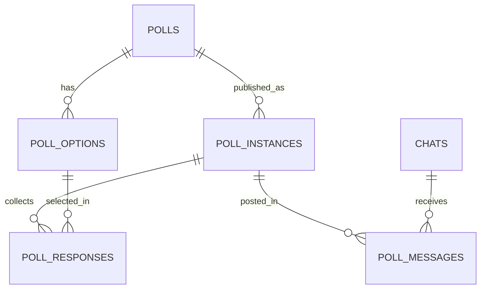

# Proposed Constitution Amendment — v2.0.0

| Field | Value |
|---|---|
| Status | Approved at G2 on 2026-11-02; apply to `CONSTITUTION.md` in the implementation PR |
| Date | 2026-11-02 |
| Current version | 1.0.0 (ratified 2026-10-31) |
| Proposed version | 2.0.0 (MAJOR) |
| Owner | @ReivaxBoido |
| Related | SPEC-003, issue #7, ADR-0003, ADR-0004 |

> This file is a **proposal**, not the constitution. It is applied to `CONSTITUTION.md` only after G2
> approval. Until then, v1.0.0 remains binding and no production code may depend on this proposal.

## Why MAJOR

The amendment changes the mission, the product's core entity, a hard privacy rule (C-7), the
authorization model for callbacks, the data model, the Telegram UX, the retention policy, and the
metric catalog. It invalidates the native-poll direction of SPEC-001 and SPEC-002. Under §18.2 this is
a MAJOR amendment.

## Summary of changes

| Area | v1.0.0 | v2.0.0 |
|---|---|---|
| Product | Native Telegram polls sent on a schedule | CountMeIn-style sign-up polls with live name lists; scheduled posting returns in SPEC-004 |
| Core entity | `polls` with `options_json` | `polls`, `poll_options`, `poll_instances`, `poll_messages`, `poll_responses` |
| Participant data | Never stored (C-7) | Telegram user ID + first-name snapshot per response; no usernames/last names |
| Callback auth | Admin allowlist only | Admin callbacks DM+allowlist; vote callbacks validated against stored message/instance/option |
| Delivery | `sendPoll` | `sendMessage` + `editMessageText` |
| Scheduling | In scope from v1 | SPEC-004; SPEC-003 ships a heartbeat only |
| Retention | Deliveries/audit | Responses, messages, audit; response retention and redaction |
| Metrics | Poll/delivery metrics | Poll/instance/message/vote/edit metrics |

## Section replacements

### Header and at-a-glance

Replace the version with `2.0.0`, status `Ratified` after approval, ratified on the approval date,
supersedes `1.0.0`. Replace the at-a-glance rows with:

| Question | Answer |
|---|---|
| What is it? | A private Telegram bot that publishes CountMeIn-style sign-up polls to registered groups and channels, manually and (from SPEC-004) on a schedule. |
| Admin interface | Telegram direct messages only, restricted by a numeric user-ID allowlist. No web UI. |
| Polls | Title 1–300 chars, 1–10 options of 1–100 chars, multi-select responses, first-name display. |
| Participants | Any member of a target chat may add or remove their own name via inline buttons. |
| Schedules | Deferred to SPEC-004; the v0.3.0-alpha milestone is manual-only. |
| Delivery | At most once per instance per chat; bounded retries; admin alerts. |
| Stack | Python 3.12, `uv`, `python-telegram-bot`, APScheduler (heartbeat/retention), SQLAlchemy 2.0 + SQLite (WAL), Alembic, `aiohttp`. |
| Deployment | One Docker container on one VPS via Docker Compose. Exactly one replica. |
| Quality | `ruff`, `mypy --strict`, `pytest` at 100% line and branch coverage, plus SAST, dependency, secret, and container scans. |
| Process | The 17-step SDD workflow with four human gates (G1–G4) defined in §12. |

### §1.1 Mission

> **`telegram-auto-poll` is a private Telegram bot that publishes CountMeIn-style sign-up polls to
> configured groups and channels, manually and on a schedule.** An administrator creates a poll with a
> title and 1–10 options and publishes it to registered chats. Members of those chats tap an option to
> add or remove their own name; the bot edits the message so everyone sees the current list and count.
> Administrators manage polls and chats entirely through direct messages; no web interface exists.
> From SPEC-004, a poll may also be published automatically at recurring intervals.

### §1.2 In scope

Replace items 2–6 with:

1. Telegram only, one bot token, one deployment.
2. CountMeIn-style sign-up polls:
   - a title (1–300 characters);
   - 1–10 options (each 1–100 characters, unique after trimming and case folding);
   - multi-select responses;
   - first-name display only;
   - one button per option.
3. Any member of a target chat may toggle their own response; responses are global to a poll instance.
4. Manual publishing to one or more registered groups, supergroups, or channels.
5. Close, reopen, refresh, and delete; deletion removes responses and redacts messages.
6. Scheduled posting (SPEC-004): daily, weekly, monthly, and one-off occurrences, per-schedule IANA
   timezone, start/end dates, pause/resume.
7. Admin access via a Telegram user-ID allowlist supplied through environment variables.
8. Admin command interface with guided inline-keyboard wizards and shortcuts.
9. Chat registration by forwarding a message or pasting a chat ID.
10. Idempotent posting, bounded retries, missed-run handling, and admin alerts.
11. Response, message, and audit retention; structured logs; health and Prometheus metrics.
12. Docker image and Docker Compose deployment on a single VPS.
13. 100% line and branch test coverage of application code, strict typing, and automated security checks.

### §1.3 Out of scope

Replace the list with:

- Web UI, REST API, or any browser-based administration.
- Native Telegram polls (`sendPoll`), quizzes, media polls, poll results ingestion, or vote analytics.
- Capacity limits, waitlists, payments, ticketing, or calendar integrations.
- Per-chat response isolation (responses are global per instance; a future spec may add isolation).
- Editing a poll title or options after creation (SPEC-005).
- Inline mode (SPEC-005).
- Multiple bot tokens, multi-tenant operation, or multiple simultaneous deployments.
- Horizontal scaling, multiple replicas, PostgreSQL, Redis, or an external job queue.
- Platforms other than Telegram.
- Internationalization.
- Runtime management of the admin allowlist.
- Automatic deployment from CI to the VPS.
- Public distribution of the bot.

### §1.4 C-7

Replace C-7 with:

| ID | Constraint | Reason |
|---|---|---|
| C-7 | The bot stores only the minimum respondent data needed for sign-up polls: Telegram user ID, a first-name snapshot, and timestamps. It never stores usernames, last names, native poll results, or vote history beyond the current response set. | Privacy by design; CountMeIn parity requires names, but no more than necessary. |

### §3.1 Context and components

Replace the component list with:

1. **Telegram bot** — receives admin updates and participant callbacks via long polling; sends and
   edits poll messages.
2. **Posting worker** — drains pending `poll_messages` with rate limiting and retries.
3. **Response broadcaster** — coalesces vote events and edits all messages for an instance.
4. **Scheduler heartbeat** — records liveness; due-schedule evaluation returns in SPEC-004.
5. **Observability sidecar** — serves `/livez`, `/healthz`, and `/metrics` on the private container
   interface, published only on host loopback.

Replace the component table rows for `bot/`, `domain/`, `services/`, `db/`, `scheduler/`, and
`observability/` with the new responsibilities: sign-up poll definitions, instances, messages,
responses, rendering, voting, broadcasting, and posting.

### §3.4 Data flow

Replace with:

1. An admin creates a poll in a DM: title and 1–10 options.
2. The admin publishes it to one or more registered chats. The service inserts one `poll_instances` row
   and one `poll_messages` row per chat in one transaction.
3. The posting worker sends each pending message with `sendMessage`, storing the Telegram message ID.
4. A member taps an option. The vote callback is validated against the stored message, open instance,
   and option; the response is inserted or deleted.
5. The broadcaster renders the instance once and edits every sent message for that instance with
   bounded concurrency and coalescing.
6. The admin may close, reopen, refresh, or delete. Closing removes the keyboard; deleting removes
   responses and redacts messages.
7. SPEC-004 adds due-schedule evaluation that creates instances with `trigger='scheduled'` and applies
   the grace window and idempotency rules.

### §3.5 Lifecycle

Startup: parse config; configure logging; lock; open DB; backup and migrate; recover `sending`
messages; start the observability sidecar; start the heartbeat, posting worker, and broadcaster; start
long polling; log `startup_complete`.

Shutdown: stop updates; stop the worker and broadcaster from claiming new work; flush broadcasts for at
most `SHUTDOWN_GRACE_SECONDS`; checkpoint WAL; close DB; release lock; exit 0.

### §5.1 Entity relationships

Replace the ER diagram with:

### §5.2 Tables

Replace the `polls`, `poll_targets`, `schedules`, and `deliveries` subsections with the five new tables
from SPEC-003 §7.1. Keep `chats` and `audit_events`, widening `entity_type` to include
`poll_instance`. The `schedules` table returns in SPEC-004 with the new instance model.

### §5.3 Invariants

Keep I-1–I-15 where they still apply, and replace the poll/delivery invariants with I-16–I-30 from
SPEC-003 §7.2. In particular:

- A poll title is 1–300; 1–10 options; labels 1–100 and unique.
- A deleted poll has no open instance and no responses.
- An open instance accepts responses; closed/deleted do not.
- A user has at most one response per option per instance.
- A message row has either a chat ID or an inline message ID.
- No usernames, last names, native poll results, or vote history are stored.

### §5.4 State machines

Replace with:

- **Poll:** `draft` → `active` → `deleted`.
- **Instance:** `open` → `closed` → `open`; `open`/`closed` → `deleted`.
- **Message:** `pending` → `sending` → `sent` | `failed` | `skipped`; `sent` → `missing`;
  `failed` → `pending` on refresh; `sending` at startup → `failed` (ambiguous).
- **Response:** present/absent; toggled by the participant.

### §6.1 Admin access

Replace with:

- Admin commands are accepted only in private chats from `ADMIN_USER_IDS`.
- Admin callbacks (`p`, `t`, `w`, `c`) require a private chat and an allowlisted actor.
- Vote callbacks (`v`) are accepted from any member of a target chat; they are validated against the
  stored message, open instance, and option. Callback data is never identity.
- Commands in groups/channels are ignored. The bot posts only poll messages and edits them.
- Non-allowlisted users receive a single generic reply in DM; they cannot run commands.
- Admin lockout recovery is unchanged.

### §6.2 Rate limiting

Keep the admin command buckets. Add a per-user vote bucket (`VOTES_PER_MINUTE`, default 30) with a
retry-after reply and no mutation. Vote state is ephemeral and resets on restart.

### §6.3 Target chat registration

Unchanged, except that registered chats are used for publishing sign-up polls rather than native polls.

### §6.4 Poll management

Replace with the SPEC-003 commands: `/newpoll`, `/polls`, `/poll`, `/publish`, `/close`, `/reopen`,
`/refresh`, `/responses`, `/deletepoll`, `/cancel`. Poll creation validates title/options and writes a
draft; publishing creates an instance and messages; closing/reopening edits messages; deletion removes
responses and redacts messages. Editing title/options is SPEC-005.

### §6.5 Posting and delivery

Replace with the SPEC-003 posting worker rules (sendMessage, at-most-once per instance/chat, retries,
skip inactive chats, alerts). Add a subsection for SPEC-004 scheduled posting: due schedules create
instances, the grace window applies, and the unique index on `(poll_id, schedule_id, scheduled_for_utc)`
suppresses duplicates. Until SPEC-004, the scheduler heartbeat is the only scheduler component.

### §6.6 Status, health, and audit

Replace `/status` fields with the SPEC-003 set. `/healthz` requires DB and posting-worker heartbeat;
the scheduler heartbeat returns in SPEC-004. Audit admin mutations only; votes are not audited.

### §6.7 Retention

Replace with:

- Responses for open instances are never pruned.
- Responses for closed/deleted instances older than `RESPONSE_RETENTION_DAYS` (default 90) are pruned
  after an attempt to redact their sent messages.
- `poll_messages` and `audit_events` older than `RETENTION_DAYS` (default 90) are pruned in batches.
- Poll definitions are retained until deleted; deletion removes responses immediately.
- The job is idempotent, batched, and logged.

### §7.2 Command reference

Replace with the SPEC-003 command table. Remove `/sendnow`, `/resend`, `/archive`, `/unarchive`,
`/schedules`, `/schedule`, `/pause`, `/resume`, `/delete_schedule` until SPEC-004/005. Add `/publish`,
`/close`, `/reopen`, `/refresh`, `/responses`, `/deletepoll`.

### §7.3 Wizard flows

Replace the new-poll wizard with the SPEC-003 flow (title, options, preview, create draft) and add the
publish target-selection flow.

### §7.4 Callback data

Replace with the SPEC-003 namespaces (`v`, `p`, `t`, `w`, `c`), the 64-byte limit, and the actor rules.

### §8.1 Configuration

Add the eight new variables from SPEC-003 §5.1/plan §2.5. Keep the existing variables needed by
SPEC-004. Remove native-poll-only variables when SPEC-004 removes the old schedule code, except
`DEFAULT_TIMEZONE`, `SCHEDULER_TICK_SECONDS`, `SEND_GRACE_SECONDS`, and the retry/concurrency settings,
which are reserved for SPEC-004.

### §9 Non-functional requirements

Update NFR-2 (zero duplicate posts per instance/chat), NFR-4 (capacity: 50 chats, 200 polls, 1,000
instances, 500 posts/day, 10,000 responses), NFR-7 (vote-to-edit p95 ≤2 s), and add NFR-13 (response
privacy: no names in logs/metrics; deletion within one retention cycle). Keep the rest.

### §10 Security and privacy

- §10.1: add respondent data, forged vote callbacks, vote spam, message-edit abuse, and cross-chat
  visibility to the threat model.
- §10.2: split admin and vote authorization; validate vote callbacks against stored messages; keep
  parameterized SQL, plain text, secret redaction, and least privilege.
- §10.5: replace "no voter data" with the minimal respondent data policy, deletion procedure, and
  cross-chat visibility warning. The bot still never calls `getPollResults` or `stopPoll`.

### §11.4 Test matrix

Replace the delivery matrix with the SPEC-003 matrix: validation, renderer, callback codec/auth,
toggle/multi-select, broadcaster coalescing, posting worker, migration guard, retention, deletion,
health/metrics, and no names in logs.

### §16.3 Metrics

Replace the native poll/delivery metrics with the SPEC-003 catalog: `tap_polls_total{status}`,
`tap_poll_instances_open`, `tap_poll_messages_total{status}`, `tap_votes_total{action}`,
`tap_vote_rejections_total{reason}`, `tap_message_edits_total{status}`,
`tap_broadcast_coalesced_total`, `tap_responses_active`, `tap_vote_to_edit_seconds`,
`tap_response_retention_deleted_total{kind}`. Keep build, DB, bot polling, send duration, admin command,
and retention metrics. No chat/user IDs in labels.

### §21 Glossary

Add: **Instance**, **Message**, **Response**, **Participant**, **Broadcaster**, **Coalescing**.
Redefine **Poll** as a title plus options, not a native Telegram poll.

### §22.4 Amendment log

Add:

| Version | Date | Change | Approved by |
|---|---|---|---|
| 2.0.0 | 2026-11-02 | CountMeIn pivot: sign-up polls, minimal respondent storage, participant callbacks, new data model, retention, metrics, and the SPEC-003/004/005 roadmap. | @ReivaxBoido (G2) |

### §22.6 ADR index

Add ADR-0003 and ADR-0004, and mark the native-poll direction of SPEC-001/002 as superseded by
SPEC-003.

## Approval

This proposal is applied only after:

1. G1 answers are recorded (done, SPEC-003 §14).
2. G2 approves SPEC-003, this amendment, and ADR-0003/0004.
3. The maintainer merges the planning PR.

After approval, `CONSTITUTION.md` header becomes v2.0.0, the amendment log is updated, and the ADR
statuses become `Accepted`.
